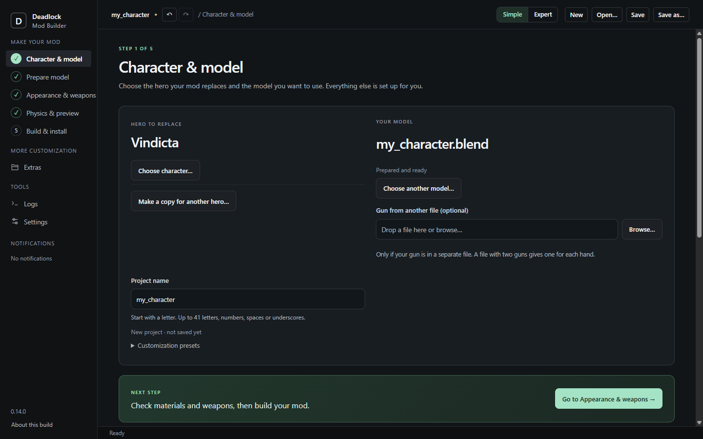
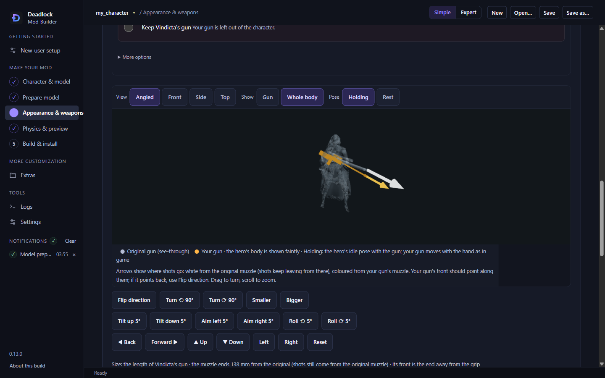
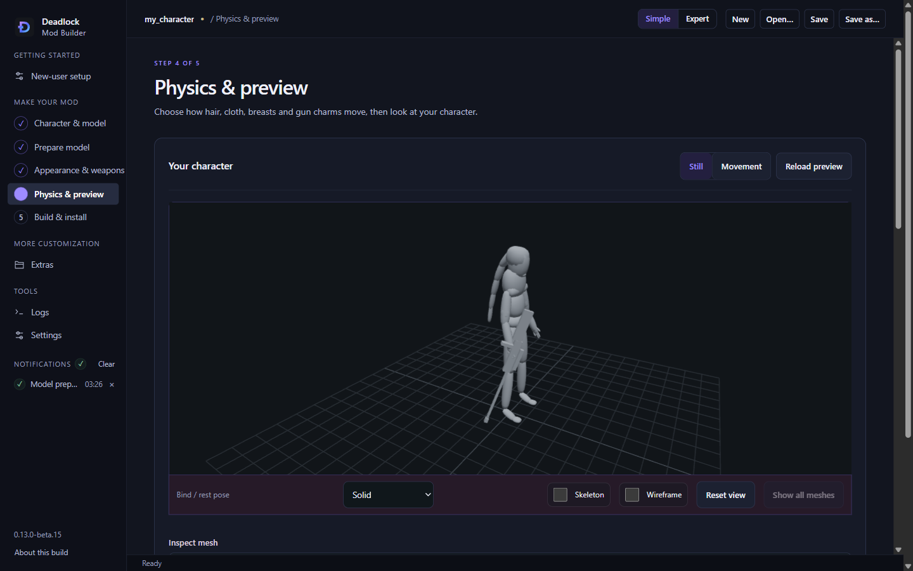
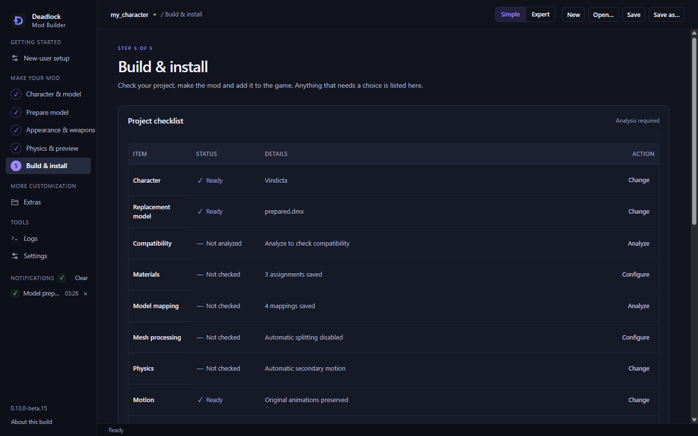

# Deadlock Mod Builder

Deadlock Mod Builder is a Windows desktop app that turns a character model into a Deadlock hero replacement mod. Pick the hero, add your model, review the guns, materials and movement, then build and install a VPK, all in one app. Blender runs in the background to prepare the model; no separate Python installation is needed.

*Character & model: pick the hero to replace and your model file. The pictures on this page use a plain example model.*

## Features

- **Five guided steps** from your model file to an installed mod, with a new-user guide and plain-language explanations. Simple mode shows only what a first mod needs; Expert shows everything.
- **Works with real-world rigs:** Mixamo, Rigify, DAZ, Character Creator, MMD and ValveBiped naming, unusual bone names, cluttered scenes, game rips and models with shape keys.
- **Guns:** use the gun in your model or in a separate gun file, including dual-wield heroes and gun charms that swing, with a live 3D fit preview in the hero's hands.
- **Materials:** textures are found in your model's materials, with a color editor, texture replacement and a review list before building.
- **Movement:** hair, tails, ears, skirts, cloth and streamers move on their own, with Fine-tune sliders, saved presets and a Movement preview of the hero's stand, run and jump.
- **Setup that checks itself:** every tool path is checked as you type with one-click fixes, Test my setup tries the compilers, and every error says what to do.
- **Extras:** hero icons, ability images and sounds, and hero colors that recolor the hero's own clothes without a replacement model.
- **Installed mods:** Build & install lists the VPKs in the game's addons folder and repairs hero models compiled before the game's October 2026 camera attachment change, keeping a backup.

## What you need

- Windows 11 x64 (Windows 10 x64 should work; untested).
- [Microsoft Edge WebView2 Runtime](https://developer.microsoft.com/microsoft-edge/webview2/). The installer adds it if it is missing.

Install these four tools:

| Tool | Used for |
| --- | --- |
| Deadlock, installed through Steam | Choosing heroes, building and installing |
| [Blender](https://www.blender.org/) 4.2–4.5, 5.0, 5.2 LTS (recommended) or 5.3 | Preparing Blender, FBX and glTF models |
| [Source 2 Viewer CLI](https://github.com/ValveResourceFormat/ValveResourceFormat/releases) | Extracting and decompiling game assets |
| [Reduced CSDK 13](https://deadlockmodding.pages.dev/modding-tools/csdk-13) | Compiling the materials and the hero model |

Nothing else is needed: no separate model compiler, DepotDownloader, Counter-Strike 2 tools or Reduced CSDK 12. Older setups that use a downloaded model toolset keep working.

The app does not include Valve tools, game files or third-party character models.

## Installation

1. Download `DeadlockModBuilder-v<version>-windows-x64-setup.exe` from the [Releases](https://github.com/OverseerAlbedo/deadlock-mod-builder/releases) page. Each release lists the installer's SHA-256.
2. Run the installer and start **Deadlock Mod Builder**.
3. On first start the new-user guide opens. Point the app at the four tools (**Detect tools** finds most of them), click **Save and check tools**, then **Test my setup**.

## Quick start

1. **Character & model:** choose the hero to replace and your model file (Blender, FBX, glTF/GLB or a prepared DMX). Optionally choose a separate gun file. Preparation starts automatically.
2. **Prepare model:** usually finishes on its own; if it stops, it names what to decide (a joint match, a shape-key choice) with a button to each spot.

3. **Appearance & weapons:** check the gun fit in the 3D preview, review the materials and textures, and accept them.

   
   *Appearance & weapons: the fit preview shows your gun over the hero's own, with buttons to turn, tilt and move it.*

4. **Physics & preview:** switch moving parts on or off, fine-tune their movement, and watch the character stand, run and jump.

   
   *Physics & preview: look at your prepared character in 3D and choose how its moving parts move.*

5. **Build & install:** analyze, build and install, then check the character in Deadlock. The page lists what to look at in game.

   
   *Build & install: the project checklist before building.*

Projects are saved as `.dmb.json` files. The full walkthrough is in [docs/MODEL_PREPARATION.md](docs/MODEL_PREPARATION.md).

## Troubleshooting

- **A path is red in Settings:** use the **Use …** fix it offers, or **Fix all marked paths**, then **Test my setup**.
- **Preparation stops:** the Prepare model step names the object or joint and offers a button to it. Rigs driven by live controls may need a baked export.
- **A validation blocks the build:** fix the reported input; bypassing a check produces a broken or unchanged mod.
- **Wrong model in game:** check the hero's model path, the VPK slot (Analyze reports a slot another mod uses) and conflicting mods.
- **Movement differs in game:** the preview approximates the game's cloth; adjust the Fine-tune sliders, analyze and build again.

More in [docs/TROUBLESHOOTING.md](docs/TROUBLESHOOTING.md).

## Privacy

- The app makes no network requests of its own: no telemetry, no update checks. Download links open in your browser. The optional model toolset download for older setups uses DepotDownloader with your own Steam account; the app never sees your password.
- Logs and **Copy for support** write your Windows user folder as `C:\Users\<you>`.
- Mods you build contain only your model, materials and textures.

## Documentation

| Document | Contents |
| --- | --- |
| [Model preparation](docs/MODEL_PREPARATION.md) | The five steps, bone mapping, textures, moving parts, the movement preview, gun customization |
| [Troubleshooting](docs/TROUBLESHOOTING.md) | Compatibility limits and fixes for common failures |
| [Release notes](docs/RELEASE_NOTES.md) · [Changelog](CHANGELOG.md) | What changed in each release |
| [Development](docs/DEVELOPMENT.md) | Building, testing and the project structure |
| [Third-party notices](docs/THIRD_PARTY.md) | Licenses of bundled components |

## Building from source

The app is built with Tauri 2, Rust, React and TypeScript. You need Node.js 24, Rust 1.99.0 with the MSVC target, Visual Studio Build Tools with a Windows SDK, and PowerShell 7. The build and test commands, the Blender test harness and the project structure are in [docs/DEVELOPMENT.md](docs/DEVELOPMENT.md).

## Contributing and support

Bug reports and feature requests go through the [issue templates](https://github.com/OverseerAlbedo/deadlock-mod-builder/issues/new/choose). Include the app version (Settings → About this build), the source file format, the hero and model, the steps, and the text from **Copy for support** (on the error's full details: **Show details**, or **Show full details** in Notifications). For code changes, see [CONTRIBUTING.md](CONTRIBUTING.md).

## Security

See [SECURITY.md](SECURITY.md). The app runs Blender and the game's resource tools on files you choose and writes to your Deadlock installation's `addons` folder: only open source files and projects you trust.

## License

The application source is licensed under the [MIT License](LICENSE). Bundled third-party components keep their own licenses; see [docs/THIRD_PARTY.md](docs/THIRD_PARTY.md). The license grants no rights to Valve assets or to users' models and textures.

This is an unofficial tool, not affiliated with or endorsed by Valve. Deadlock and its assets belong to their respective owners.
