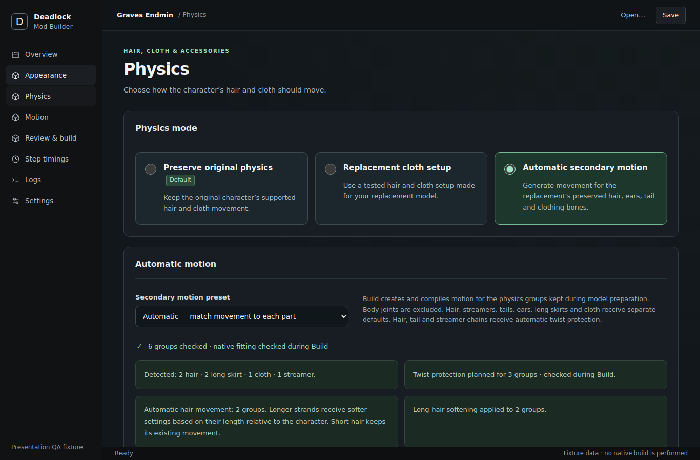

# Deadlock Mod Builder

[](https://github.com/OverseerAlbedo/deadlock-mod-builder/actions/workflows/windows.yml)
[](https://github.com/OverseerAlbedo/deadlock-mod-builder/releases)
[](LICENSE)

Turn a character model into a Deadlock hero replacement mod: pick the hero, drop in your model, review the guns, materials and movement, then build and install a VPK — all from one Windows desktop application.

Built with **Tauri 2, Rust, React and TypeScript**. Blender runs in the background as a geometry engine for model preparation; no separate Python installation is needed. The app never contacts the network itself.


*The Physics step with sample project data. UI capture, not an in-game simulation.*

> **Status:** beta. Releases are tested on the maintainer's machines and in CI; the [release notes](docs/RELEASE_NOTES.md) list what has and has not been checked in game.

## Table of contents

- [Features](#features)
- [Requirements](#requirements)
- [Installation](#installation)
- [Quick start](#quick-start)
- [Privacy](#privacy)
- [Documentation](#documentation)
- [Building from source](#building-from-source)
- [Project structure](#project-structure)
- [Troubleshooting](#troubleshooting)
- [Contributing and support](#contributing-and-support)
- [Security](#security)
- [License](#license)

## Features

- **Five guided steps:** Character & model → Prepare model → Appearance & weapons → Physics & preview → Build & install, with automatic preparation of Blender, FBX and glTF models, a new-user guide, and plain-language explanations wherever a choice is needed. **Simple** mode shows only what a first mod needs; **Expert** shows everything.
- **Works with real-world rigs:** common naming conventions (Mixamo, Rigify, DAZ, Character Creator, MMD, ValveBiped), rigs with unusual bone names, cluttered scenes, game rips, models with shape keys, and heroes with extreme proportions. See [model preparation](docs/MODEL_PREPARATION.md).
- **Guns:** replace the hero's gun with the one in your model or in a separate gun file, including dual-wield heroes, gun charms that swing, a live 3D fit preview in the hero's holding pose, and separate weapon models built into the same mod.
- **Materials:** textures recovered from the model's materials, baked texture atlases, decals, a color editor and texture replacement, readable names for Chinese, Japanese and Korean material names, and a review list before building.
- **Movement:** automatic secondary motion for hair, tails, ears, skirts, cloth, streamers and gun charms, optional breast and butt motion, rigid accessories, per-part-type **Fine-tune** sliders with saved presets, and a **Movement** preview that plays the hero's stand, run and jump with your moving parts swinging.
- **Setup that checks itself:** every tool path is checked as you type with one-click fixes, **Test my setup** compiles a test material and probes the model compiler, and every error says what to do and where.
- **Extras:** hero icons, ability images and sounds, with previews and drag-and-drop replacement.
- **Themes:** Original, Violet D and Mint D, plus a customizer that builds a theme from three colors (color picker or hex) with a live preview and saves it as a preset.
- **Trustworthy builds:** every stage is hash-verified, compiled with the official Source 2 toolset, validated against the installed game, packaged as a VPK and installed in place, with autosave and recovery, complete tool logs and step timings.

Compatibility depends on the input model, the game's current resource formats and the configured tools. See [troubleshooting](docs/TROUBLESHOOTING.md).

## Requirements

| Requirement | Needed for | Included |
| --- | --- | --- |
| Windows 11 x64 (Windows 10 x64 should work; untested) | Running the app | — |
| [Microsoft Edge WebView2 Runtime](https://developer.microsoft.com/microsoft-edge/webview2/) | The interface (present on current Windows) | Installer adds it if missing |
| Deadlock, installed through Steam | Choosing heroes, building and installing | No |
| [Source 2 Viewer CLI](https://github.com/ValveResourceFormat/ValveResourceFormat/releases) | Extracting and decompiling game assets | No |
| Reduced CSDK 12 (material compiler) | Compiling materials | No |
| Source 2 model toolset (downloaded in-app with DepotDownloader and your Steam account) | Compiling models | No |
| [Blender](https://www.blender.org/) 4.2–4.5, 5.0 or 5.2 LTS | Preparing Blender, FBX and glTF models | No |
| Cloth reader, physics references | Independent verification of movement setups | Yes |

The app does not include Valve tools, game files or third-party character models. **Settings** (and the new-user guide) check every configured tool and explain what is missing.

## Installation

1. Download `DeadlockModBuilder-v<version>-windows-x64-setup.exe` from the [Releases](https://github.com/OverseerAlbedo/deadlock-mod-builder/releases) page. Each release lists the installer's SHA-256.
2. Run the installer and start **Deadlock Mod Builder**.
3. On first start the new-user guide opens: point the app at Deadlock, Source 2 Viewer CLI, the Reduced CSDK and Blender, download the model toolset, and run **Test my setup**.

Settings, projects' working data and logs live under `%LOCALAPPDATA%\DeadlockModBuilder`. A portable build (`DeadlockModBuilder` folder, no installer) is produced by the Windows workflow and by [building from source](#building-from-source).

## Quick start

1. **Character & model:** choose the hero to replace and your model file (Blender, FBX, glTF/GLB or a prepared DMX). Optionally choose a separate gun file. Preparation starts automatically.
2. **Prepare model:** usually finishes on its own; if it stops, it names what to decide (a joint match, a shape-key choice) with a button to each spot.
3. **Appearance & weapons:** check the gun fit in the 3D preview, review the materials and textures, and accept them.
4. **Physics & preview:** switch moving parts on or off, fine-tune their movement, and watch the character stand, run and jump.
5. **Build & install:** analyze, build and install; then check the character in Deadlock. The page lists what to look at in game.

Projects are saved as `.dmb.json` files. The full walkthrough is in [docs/MODEL_PREPARATION.md](docs/MODEL_PREPARATION.md).

## Privacy

- The app makes no network requests of its own: no telemetry, no update checks. The tool download links open in your browser, and DepotDownloader (for the model toolset) talks to Steam with the account you give it; the app never sees or stores your Steam password.
- Logs shown in the app, exported logs and **Copy for support** write your Windows user folder as `C:\Users\<you>`; command receipts leave out the Steam account name.
- Builds made from source map the builder's user folder out of the program. Release installers are built by GitHub Actions.
- Mods you build contain your model, materials and textures and nothing about your PC.

## Documentation

| Document | Contents |
| --- | --- |
| [Model preparation](docs/MODEL_PREPARATION.md) | The five steps, scene isolation, bone mapping, textures, moving parts, the movement preview, gun customization, themes, verification |
| [Troubleshooting](docs/TROUBLESHOOTING.md) | Compatibility limits and fixes for common failures |
| [Development](docs/DEVELOPMENT.md) | Build, test and Blender harness commands |
| [Releasing](docs/RELEASING.md) · [Release validation](docs/RELEASE_VALIDATION.md) | Release procedure and the checks a release needs |
| [Release notes](docs/RELEASE_NOTES.md) · [Changelog](CHANGELOG.md) | What changed, and what is still unverified in game |
| [Third-party notices](docs/THIRD_PARTY.md) | Licenses of bundled components |

## Building from source

Prerequisites on Windows:

- Node.js 24 with npm (`.node-version`)
- Rust 1.99.0 with the MSVC target (`rust-toolchain.toml`)
- Visual Studio Build Tools with *Desktop development with C++* and a Windows SDK
- Microsoft Edge WebView2 Runtime
- PowerShell 7 for the build and release scripts

```powershell
npm ci
node scripts/check-repository.mjs
npm test -- --maxWorkers=2
cargo test --manifest-path src-tauri/Cargo.toml --workspace --locked
npm run tauri -- dev
```

`npm run dev` serves only the browser frontend; native operations need `npm run tauri -- dev`.

The TangTang presets and a few test fixtures come from a separate private repository (`private-assets/`, see [docs/DEVELOPMENT.md](docs/DEVELOPMENT.md#private-assets)); the app builds and tests without it, offering Automatic movement only.

The same tests, portable build and startup check as CI:

```powershell
pwsh -NoProfile -File scripts/build-windows.ps1
```

Outputs land in `artifacts/portable/` (the portable app), `artifacts/release/` (checksums; the installer with `-Release`) and `artifacts/validation/` (logs). Nothing is published by this script; releases go through the manual **Release** workflow described in [docs/RELEASING.md](docs/RELEASING.md). The optional Blender harness that runs 28 awkward rigs through the whole preparation is described in [docs/DEVELOPMENT.md](docs/DEVELOPMENT.md).

## Project structure

| Path | Purpose |
| --- | --- |
| `src/` | React interface and its tests (`src/theme/` is the Theme Manager and customizer) |
| `src-tauri/src/` | Tauri desktop host and commands |
| `src-tauri/crates/` | Rust pipeline: preparation, materials, skeleton/DMX export, cloth, compilation, VPK, storage, tools |
| `src-tauri/crates/deadlock-preparation/resources/blender/` | Python scripts embedded into the app and run inside Blender |
| `resources/` | Hero catalog, tool recipe and hash-pinned native readers |
| `physics-references/` | Acceptance records of the Vindicta cloth references; the compiled models are private assets |
| `tools/cloth-reader/` | Source of the independent cloth reader |
| `scripts/` | Repository checks, Windows packaging, startup check and Blender test harnesses |
| `docs/` | Documentation |
| `.github/workflows/` | CI: tests and portable build on every push; manual release workflow |
| `licenses/` | Third-party notices |

## Troubleshooting

- **A path is red in Settings:** use the **Use …** fix it offers, or **Fix all marked paths**, then **Test my setup**.
- **Preparation stops:** the Prepare model step names the object or joint and offers a button to it. Rigs driven by live controls may need a baked export.
- **Build fails in the compiler:** keep the complete toolset together (do not mix compiler DLL versions) and use **Copy for support** on the error.
- **A validation blocks the build:** fix the reported input; bypassing a check produces a broken or unchanged mod.
- **Wrong model in game:** check the hero's model path, the VPK slot (Analyze reports a slot another mod uses) and conflicting mods.
- **Movement differs in game:** the preview approximates the game's cloth; keep the prepared moving parts, adjust the Fine-tune sliders, analyze and build again.

More in [docs/TROUBLESHOOTING.md](docs/TROUBLESHOOTING.md).

## Contributing and support

Bug reports and feature requests go through the [issue templates](https://github.com/OverseerAlbedo/deadlock-mod-builder/issues/new/choose); include the app version (Settings → About this build), the source file format, the hero and model, the steps, and the text from **Copy for support**. Code changes: see [CONTRIBUTING.md](CONTRIBUTING.md) — keep changes focused and run the checks above.

## Security

See [SECURITY.md](SECURITY.md). The app runs Blender and the game's resource tools on files you choose and writes to your Deadlock installation's `addons` folder: only open source files and projects you trust.

## License

The application source is licensed under the [MIT License](LICENSE). Bundled third-party components keep their own licenses; see [docs/THIRD_PARTY.md](docs/THIRD_PARTY.md). The license grants no rights to Valve assets or to users' models and textures.

This is an unofficial tool, not affiliated with or endorsed by Valve. Deadlock and its assets belong to their respective owners.
