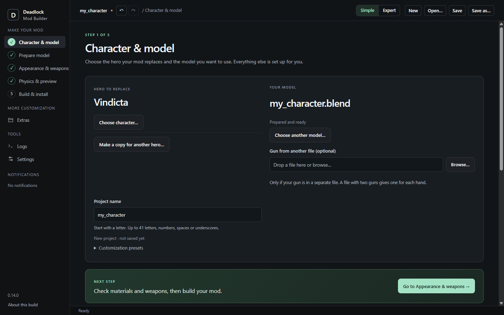
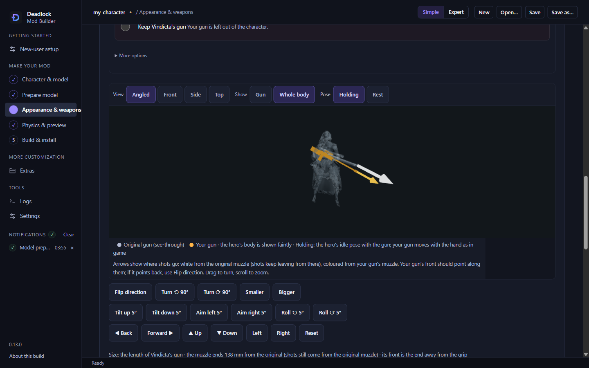
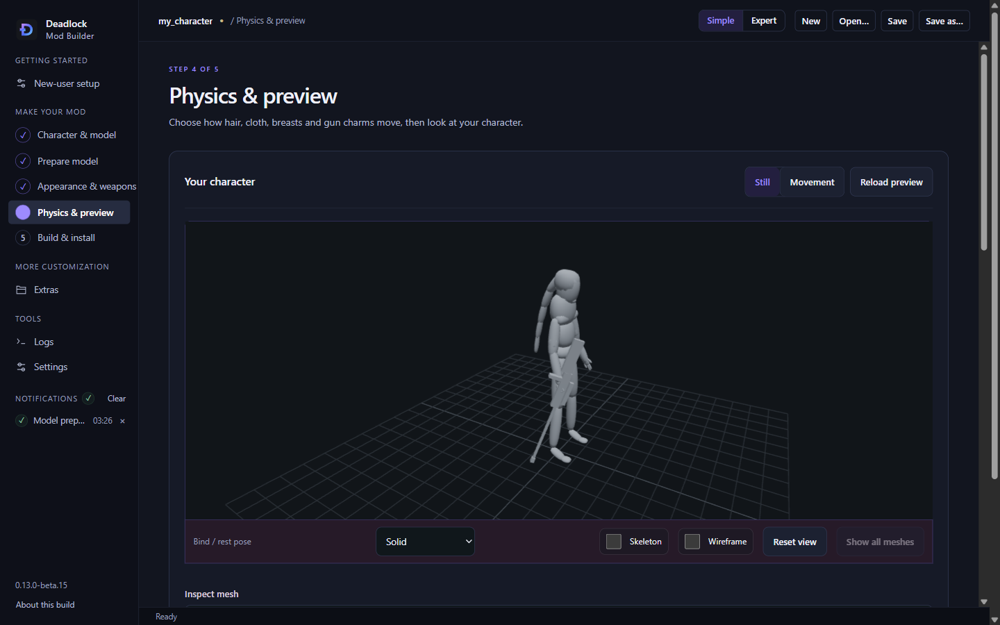
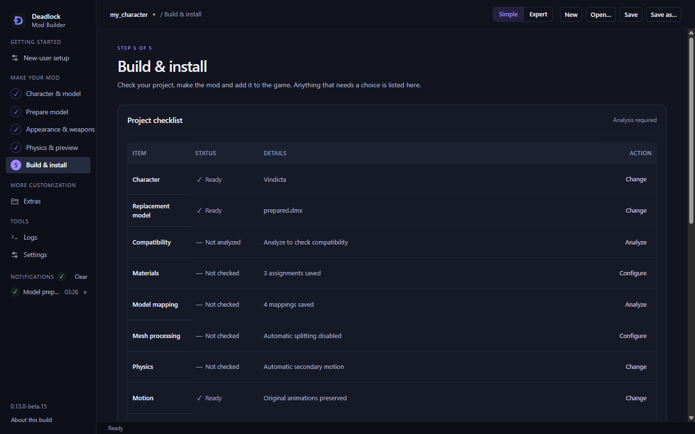

# Deadlock Mod Builder

[English](README.md) · **简体中文**

Deadlock Mod Builder 是一款 Windows 桌面应用，可以把角色模型做成 Deadlock 的英雄替换模组。选择英雄、添加你的模型、检查枪械、材质和动态效果，然后构建并安装 VPK，全部在一个应用里完成。Blender 在后台运行，负责准备模型，无需另外安装 Python。

*角色与模型（Character & model）：选择要替换的英雄和你的模型文件。本页的图片使用一个简单的示例模型，显示的是英文界面。*

## 功能

- **五个引导步骤**：从模型文件一路走到安装好的模组，附带新手引导（New-user setup）页面和通俗易懂的说明。简单（Simple）模式只显示第一个模组需要的内容；专家（Expert）模式显示全部内容。
- **适配各种实际的骨架**：支持 Mixamo、Rigify、DAZ、Character Creator、MMD 和 ValveBiped 命名，也支持不常见的骨骼名称、杂乱的场景、从游戏中提取的模型和带形态键的模型。
- **枪械**：可以使用模型中自带的枪械或单独的枪械文件，支持双持的英雄和会摆动的枪械挂饰，并在英雄手中实时显示 3D 适配预览。
- **材质**：从模型的材质中找到贴图，提供颜色编辑器和贴图替换，构建前还有一份检查列表。
- **动态效果**：头发、尾巴、耳朵、裙子、布料和飘带会自行摆动，可以用微调（Fine-tune）滑块调整、保存为预设；动态（Movement）预览会在英雄站立、奔跑、跳跃和下落时模拟游戏中的布料。
- **会自我检查的设置**：每个工具路径都会在输入时检查，并提供一键修复；“测试我的设置”（Test my setup）会试运行编译器；每个错误都会告诉你该怎么做。
- **附加内容**（Extras）：英雄图标、技能图片和声音（按英雄、技能、武器和语音分类，并可编辑播放的片段、音量和淡入淡出），为技能和武器特效重新着色，为技能物体换上你自己的模型，为商店中的物品设置新图标和新名称，还有颜色：在英雄自己的服装或你的替换模型上点击一种颜色，把它换成新的颜色，灰色、白色和黑色部分以及单个部件也可以，并带有 3D 预览。
- **动作**（Motion）：在你的角色上播放英雄的动画并替换动画片段，也可以用你在 Blender 中制作的动画，或游戏中另一位英雄的动画来替换。
- **项目**：撤销和重做、会记住文件夹的文件窗口，以及为另一位英雄制作的项目副本。
- **已安装的模组**（Installed mods）：“构建与安装”（Build & install）会说明游戏 addons 文件夹中的每个 VPK 改动了什么，并可以加上你自己的标签；它还能修复在游戏 2026 年 10 月更改摄像机附着点之前编译的英雄模型，并保留备份。
- **语言**：界面提供英文和简体中文，英雄和物品的名称采用游戏自带的中文名称。在“设置 → 外观”顶部的“语言”中选择。本页在中文名称后面的括号里给出英文界面中的名称。

## 所需环境

- Windows 11 x64（Windows 10 x64 应该也可以使用）。
- [Microsoft Edge WebView2 Runtime](https://developer.microsoft.com/microsoft-edge/webview2/)。如果缺少，安装程序会自动添加。

请安装以下四个工具：

| 工具 | 用途 |
| --- | --- |
| Deadlock，通过 Steam 安装 | 选择英雄、构建和安装 |
| [Blender](https://www.blender.org/) 4.2–4.5、5.0、5.2 LTS（推荐）或 5.3 | 准备 Blender、FBX、glTF 和 MMD 模型 |
| [Source 2 Viewer CLI](https://github.com/ValveResourceFormat/ValveResourceFormat/releases) | 提取和反编译游戏资源 |
| [Reduced CSDK 13](https://deadlockmodding.pages.dev/modding-tools/csdk-13) | 编译材质和英雄模型 |

不需要其他任何东西：不需要单独的模型编译器、DepotDownloader、Counter-Strike 2 工具或 Reduced CSDK 12。使用已下载模型工具集的旧配置仍然可以继续使用。

MikuMikuDance 模型（.pmx、.pmd）还需要在这个 Blender 中安装免费的 [MMD Tools](https://extensions.blender.org/add-ons/mmd-tools/) 插件：Edit → Preferences → Get Extensions（中文界面为 编辑 → 偏好设置 → 获取扩展），搜索 MMD Tools，然后点击 Install（安装）。其他模型不需要它。

本应用不包含 Valve 的工具、游戏文件或第三方角色模型。

## 安装

1. 从 [Releases](https://github.com/OverseerAlbedo/deadlock-mod-builder/releases) 页面下载 `DeadlockModBuilder-v<version>-windows-x64-setup.exe`。每个版本都列出了安装程序的 SHA-256。
2. 运行安装程序，然后启动 **Deadlock Mod Builder**。
3. 首次启动时会打开“新手引导”（New-user setup）页面。为应用指定这四个工具的位置（**检测工具**（Detect tools）能找到其中的大部分），点击**保存并检查工具**（Save and check tools），然后点击**测试我的设置**（Test my setup）。

## 快速上手

1. **角色与模型**（Character & model）：选择要替换的英雄和你的模型文件（Blender、FBX、glTF/GLB、MMD .pmx/.pmd 或已准备好的 DMX）。也可以另外选择一个单独的枪械文件。准备会自动开始。
2. **准备模型**（Prepare model）：通常会自行完成；如果中途停下，它会指出需要你决定的内容（关节匹配、形态键的选择），并提供直达每一处的按钮。

3. **外观与武器**（Appearance & weapons）：在 3D 预览中检查枪械的适配，检查材质和贴图，然后接受它们。

   
   *外观与武器：适配预览把你的枪械叠在英雄自己的枪械上显示，并提供旋转、倾斜和移动它的按钮。*

4. **物理与预览**（Physics & preview）：打开或关闭活动部件，微调它们的动态效果，并观看角色站立、奔跑和跳跃。

   
   *物理与预览：在 3D 中查看准备好的角色，并选择它的活动部件如何摆动。*

5. **构建与安装**（Build & install）：分析、构建并安装，然后在 Deadlock 中检查角色。页面会列出需要在游戏中查看的内容。

   
   *构建与安装：构建前的项目检查清单。*

项目保存为 `.dmb.json` 文件。完整说明见[模型准备指南](docs/MODEL_PREPARATION.md)（英文）。

## 故障排除

- **设置（Settings）中有路径显示为红色**：使用它提供的 **使用…**（Use …）修复，或点击**修复所有标记的路径**（Fix all marked paths），然后点击**测试我的设置**。
- **准备中途停下**：“准备模型”步骤会指出相关的对象或关节，并提供直达它的按钮。由实时控制器驱动的骨架可能需要先烘焙再导出。
- **验证阻止了构建**：修正报告中指出的输入；绕过检查只会得到损坏的或没有任何变化的模组。
- **游戏中的模型不对**：检查英雄的模型路径、VPK 槽位（分析（Analyze）会报告被其他模组占用的槽位）以及互相冲突的模组。
- **游戏中的动态效果与预览不同**：预览接近游戏中的布料效果，但并不完全一致；调整微调滑块，然后重新分析和构建。

更多内容见[故障排除](docs/TROUBLESHOOTING.md)（英文）。

## 隐私

- 应用本身不发出任何网络请求：没有遥测，也不检查更新。下载链接会在你的浏览器中打开。旧配置可选的模型工具集下载会使用 DepotDownloader 和你自己的 Steam 账户；应用永远看不到你的密码。
- 日志和**复制支持信息**（Copy for support）会把你的 Windows 用户文件夹写成 `C:\Users\<you>`。
- 你构建的模组只包含你的模型、材质和贴图。

## 文档

| 文档 | 内容 |
| --- | --- |
| [网站](https://overseeralbedo.github.io/deadlock-mod-builder/zh-cn/) | 下载和分步教程的网页版；指南、故障排除和更新日志的网页为英文 |
| [你的第一个模组](docs/zh-CN/FIRST_MOD.md) | 分步教程：从角色模型到游戏中的模组 |
| [模型准备](docs/MODEL_PREPARATION.md)（英文） | 五个步骤、关节匹配、贴图、活动部件、动态预览、枪械自定义，以及附加内容（声音、特效、物品图标和名称、技能物体、颜色） |
| [动作](docs/MOTION.md)（英文） | 英雄的动画：播放、替换、用你自己的动画制作的动画片段，以及从另一位英雄那里借用的动作 |
| [项目与已安装的模组](docs/PROJECTS.md)（英文） | 撤销和重做、文件窗口、为另一位英雄制作的副本、设置中的偏好、已安装模组的列表 |
| [故障排除](docs/TROUBLESHOOTING.md)（英文） | 兼容性限制和常见故障的解决方法 |
| [发布说明](docs/RELEASE_NOTES.md)（英文） · [更新日志](CHANGELOG.md)（英文） | 每个版本的更改内容 |
| [开发](docs/DEVELOPMENT.md)（英文） | 构建、测试和项目结构 |
| [第三方声明](docs/THIRD_PARTY.md)（英文） | 内置组件的许可证 |

## 从源代码构建

本应用使用 Tauri 2、Rust、React 和 TypeScript 构建。你需要 Node.js 24、带 MSVC 目标的 Rust 1.99.0、带 Windows SDK 的 Visual Studio Build Tools，以及 PowerShell 7。构建和测试命令以及项目结构见 [docs/DEVELOPMENT.md](docs/DEVELOPMENT.md)（英文）。

## 参与贡献与支持

错误报告和功能请求请通过[问题模板](https://github.com/OverseerAlbedo/deadlock-mod-builder/issues/new/choose)提交。请附上应用版本（侧边栏底部的数字）、源文件格式、英雄和模型、操作步骤，以及**复制支持信息**得到的文本（在错误的完整详情中：**显示详情**（Show details），或在通知（Notifications）中点击**显示完整详情**（Show full details））。代码贡献请参阅 [CONTRIBUTING.md](CONTRIBUTING.md)（英文）。

## 安全

请参阅 [SECURITY.md](SECURITY.md)（英文）。本应用会对你选择的文件运行 Blender 和游戏的资源工具，并写入你的 Deadlock 安装目录中的 `addons` 文件夹：只打开你信任的源文件和项目。

## 致谢

由 [Source 2 Viewer](https://s2v.app)（[ValveResourceFormat](https://github.com/ValveResourceFormat/ValveResourceFormat)）提供支持：本应用使用它的命令行工具提取和反编译游戏资源，并使用它的库读取已编译的模型。Source 2 文件格式属于 Valve；能够读取它们是该项目的成果。

## 许可证

本应用的源代码采用 [GNU Affero 通用公共许可证 v3.0 或更高版本](LICENSE)（AGPL-3.0-or-later）授权；版权声明和许可证的适用范围见 [NOTICE](NOTICE)。0.13.0 及之前的版本（包括 0.13.0）以 MIT 许可证发布。内置的第三方组件保留各自的许可证；见 [docs/THIRD_PARTY.md](docs/THIRD_PARTY.md)（英文）。该许可证不授予对 Valve 资源或用户的模型和贴图的任何权利。

本工具为非官方工具，与 Valve 无关，也未获得 Valve 的认可。Deadlock 及其资源归各自的所有者所有。
