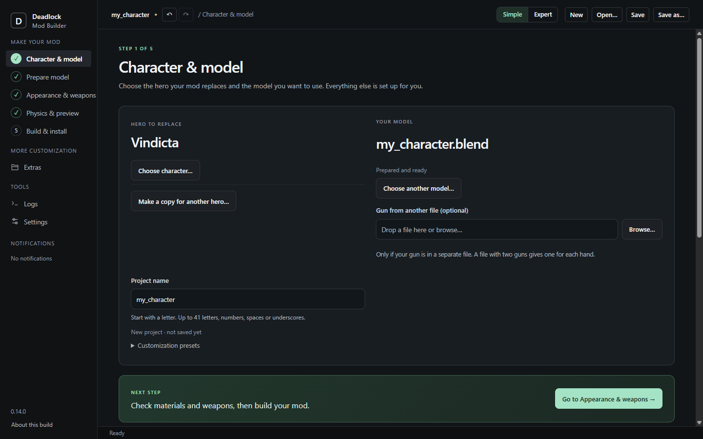
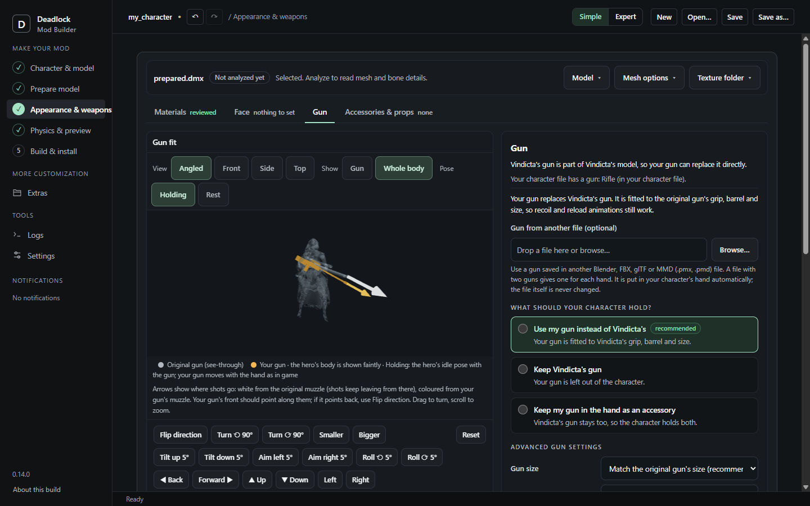
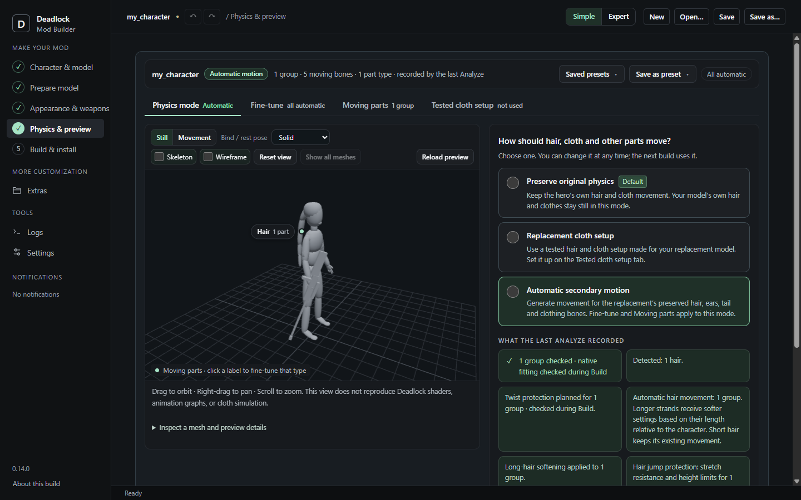
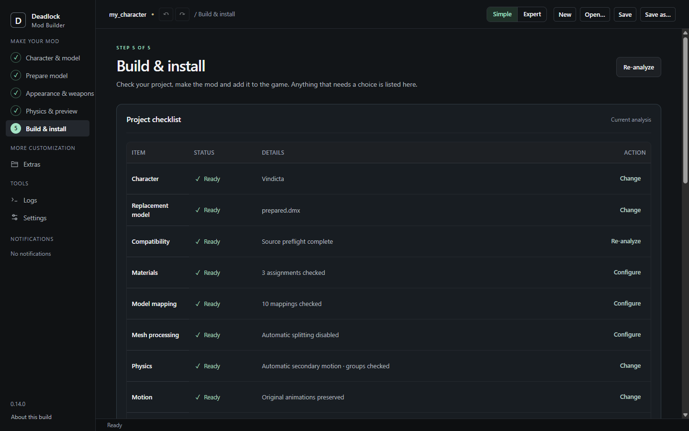

# How to make a Deadlock character mod

This tutorial takes you from a character model to a mod in Deadlock. You end
up with a VPK in the game's `addons` folder that replaces a hero's model with
yours. Deadlock Mod Builder, an open-source Windows app, leads you through five
steps. Blender runs in the background to prepare the
model; no separate Python installation is needed.

This page is the quick path. The [model preparation guide](MODEL_PREPARATION.md)
explains every step in detail.

## What you need

- Windows 11 x64. Windows 10 x64 should also work.
- [Microsoft Edge WebView2 Runtime](https://developer.microsoft.com/microsoft-edge/webview2/).
  The installer adds it if it is missing.
- These four tools:

  | Tool | Used for |
  | --- | --- |
  | Deadlock, installed through Steam | Choosing heroes, building and installing |
  | [Blender](https://www.blender.org/) 4.2–4.5, 5.0, 5.2 LTS (recommended) or 5.3 | Preparing Blender, FBX, glTF and MMD models |
  | [Source 2 Viewer CLI](https://github.com/ValveResourceFormat/ValveResourceFormat/releases) | Extracting and decompiling game assets |
  | [Reduced CSDK 13](https://deadlockmodding.pages.dev/modding-tools/csdk-13) | Compiling the materials and the hero model |

- A rigged humanoid character model: a Blender, FBX, glTF/GLB, MikuMikuDance
  (.pmx, .pmd) or prepared DMX file. Rigs with Mixamo, Rigify, DAZ, Character
  Creator, MMD or ValveBiped naming work, and so do unusual bone names. Bodies
  that are not humanoid, such as quadrupeds, still need a manual source copy
  (see [Limits](MODEL_PREPARATION.md#limits)).
- For a MikuMikuDance model only: the free
  [MMD Tools](https://extensions.blender.org/add-ons/mmd-tools/) add-on in the
  Blender the app uses. In Blender, open Edit → Preferences → Get Extensions,
  search for MMD Tools and click Install.

The app does not include Valve tools, game files or third-party character
models: you bring your own model. The app runs Blender and the game's resource
tools on files you choose and writes to your Deadlock installation's `addons`
folder, so only open source files and projects you trust.

## Install and set up

1. Download `DeadlockModBuilder-v<version>-windows-x64-setup.exe` from the
   [Releases](https://github.com/OverseerAlbedo/deadlock-mod-builder/releases)
   page. Each release lists the installer's SHA-256.
2. Run the installer and start **Deadlock Mod Builder**.
3. On first start the new-user guide opens. Point the app at the four tools
   (**Detect tools** finds most of them), click **Save and check tools**, then
   **Test my setup**.

The switch in the top bar chooses Simple or Expert. Simple is the default and
shows only what a first mod needs. Choices you must make are never hidden.

## Step 1: Character & model

Pick the hero model to replace and your model file. The hero picker lists the
model the game loads under the hero's name, and marks roster models the game
does not load as *Not used in game*. Choose the main hero model unless you want
an alternate variant.

If your gun is in a separate file, you can also choose an optional **Gun from
another file** here.

A Blender, FBX, glTF or MMD model goes straight to step 2 and is prepared
automatically.

*Character & model: pick the hero to replace and your model file. The pictures on this page use a plain example model.*

## Step 2: Prepare model

This step fits your model to the hero's exact skeleton.
**Prepare automatically** inspects your file, applies the suggestions, checks
the result, converts it and uses the model in one go, then continues to step 3.
Your own file is never written.

Preparation usually finishes on its own. If it stops, it names what to decide,
such as a joint match or a shape-key choice, with a button to each spot. When
your model has shape keys, **Shape key handling** is a required choice (Fit &
review → Shape keys).

After the check, the bar at the top of the page names your file and holds its
menus: **Model file & orientation** (to choose another file or check it again),
the preparation mode, **Scene objects** and **Notes**. The 3D view stays on the
left while you go through the tabs **Body roles**, **Moving parts**, **Joint
matches**, **Gun** and **Fit & review**; each tab shows a short status. Load
*Joint check* to see labels on the character: click a joint's label on
**Body roles** to select it, and the part of your model that its bone moves
lights up. On **Gun**, the gun's fit preview and its adjust buttons take the
place of the 3D view.

## Step 3: Appearance & weapons

Check the gun fit in the 3D preview, review the materials and textures, and
accept them. The page has four tabs (**Materials**, **Face**, **Gun**,
**Accessories & props**) beside the 3D view, and four menus in its top bar:
**Model** (replace or analyze the model, import a source package), **Mesh
options**, **Texture folder** and **Saved inputs**.

- The gun: if your model contains a gun, the **Gun** tab offers to fit it
  onto the hero's gun, leave it out, or keep it in the hand. Using your gun
  instead of the hero's is recommended and preselected. The preview shows your
  gun over the hero's own. If the gun points backwards, use **Flip direction**;
  other buttons turn, tilt and move it. **Apply gun changes** prepares the model
  again in one click.
- Materials: textures are found in your model's materials. On the
  **Materials** tab, click a material in the list or a part of the character
  in the 3D view, check its images, then tick **I have reviewed this material
  choice**; **Next to review** goes to the next one, and **Accept all** takes
  every resolved choice at once. Colors are changed in **Extras → Colors**.

*Appearance & weapons: the fit preview shows your gun over the hero's own, with buttons to turn, tilt and move it.*

## Step 4: Physics & preview

Hair, tails, ears, skirts, cloth and streamers can move on their own. Choose
**Automatic secondary motion** on the **Physics mode** tab, then fine-tune their
movement on **Fine-tune** and switch parts on or off on **Moving parts**. The
character preview stays beside every tab; click a label on the character to
fine-tune that part type.

**Movement**, in the bar above the preview, plays the hero's own clips on your
character: stand, run (forward, back and to each side), stop, jump and fall.
With Automatic secondary motion it simulates the game's own cloth model, so the
moving parts move much closer to what you see in game; still check them in a
match.

*Physics & preview: look at your prepared character in 3D and choose how its moving parts move.*

## Step 5: Build & install

Analyze, build and install. The app inspects the project, compiles the model
and materials, packs the VPK and installs it.

Before you build, look at the mesh mapping on this page. Your meshes are named
after your source (Body, Face), not after the hero's render nodes, so the page
offers a **suggested mapping**: **Apply suggested mapping** puts every mesh no
render node uses on the body in one click, keeps the hero's weapon parts and the
things the hero carries, and switches off the hero's other parts. Nothing is
applied until you click it. Source meshes that no render node uses would be
missing in game; a warning names them, with a button that adds them to the
main node.

If a check blocks the build, fix the reported input. Bypassing a check produces
a broken or unchanged mod. Analyze also reports a VPK slot another mod uses.

*Build & install: the project checklist before building.*

Projects are saved as `.dmb.json` files.

## Check it in the game

Check the character in Deadlock. The Build & install page lists what to look at
in game. A successful build and the previews do not replace a look at the
character in a match. Look at:

- the grip, aim and muzzle position (shots and muzzle flashes come from the
  original muzzle bones);
- elbow and knee bending;
- clipping;
- for heroes with a gun in each hand, the two-gun animations;
- how the moving parts move.

## If something goes wrong

- **A path is red in Settings:** use the **Use …** fix it offers, or **Fix all
  marked paths**, then **Test my setup**.
  See [Setup](TROUBLESHOOTING.md#setup).
- **Preparation stops:** the Prepare model step names the object or joint and
  offers a button to it. Rigs driven by live controls may need a baked export.
  See [Models and mapping](TROUBLESHOOTING.md#models-and-mapping).
- **The gun points backwards or is upside down:** flip or roll it in the fit
  preview, then check aim and grip in game. See
  [Guns](TROUBLESHOOTING.md#guns).
- **Wrong model in game:** check the hero's model path, the VPK slot and
  conflicting mods. See [Guns](TROUBLESHOOTING.md#guns), which also covers
  choosing the hero's main model.
- **Movement differs in game:** the preview comes close to the game's cloth
  but is not exact; adjust the Fine-tune sliders, analyze and build again. See
  [Physics](TROUBLESHOOTING.md#physics).
- **You need help:** use **Logs** and **Step timings** to find the failing
  stage, then report it with the text from **Copy for support**. See
  [Logs](TROUBLESHOOTING.md#logs).

## Next steps

- [Simple and Expert](MODEL_PREPARATION.md#simple-and-expert): what the
  Expert mode shows.
- [Guns](MODEL_PREPARATION.md#guns): heroes with two guns, a gun from another
  file, and gun charms.
- [Moving parts](MODEL_PREPARATION.md#moving-parts) and
  [the movement preview](MODEL_PREPARATION.md#fine-tune-and-the-movement-preview):
  part types, Fine-tune sliders and saved presets.
- [Colors](MODEL_PREPARATION.md#colors): recolor the hero's own clothes, or
  your replacement model's materials, by clicking a color on the character.
- The other Extras: [sounds](MODEL_PREPARATION.md#hero-sounds),
  [effects](MODEL_PREPARATION.md#hero-effects),
  [item icons](MODEL_PREPARATION.md#item-icons),
  [item names](MODEL_PREPARATION.md#item-names) and
  [ability objects](MODEL_PREPARATION.md#ability-objects).
- [Motion](MOTION.md): play the hero's animations on your character and
  replace a clip, also with your own animation or with another hero's
  animation from the game.
- [Projects and installed mods](PROJECTS.md): Undo and Redo, a copy of your
  project for another hero, and the list of installed mods.
- [Troubleshooting](TROUBLESHOOTING.md): compatibility limits and fixes for
  common failures.
