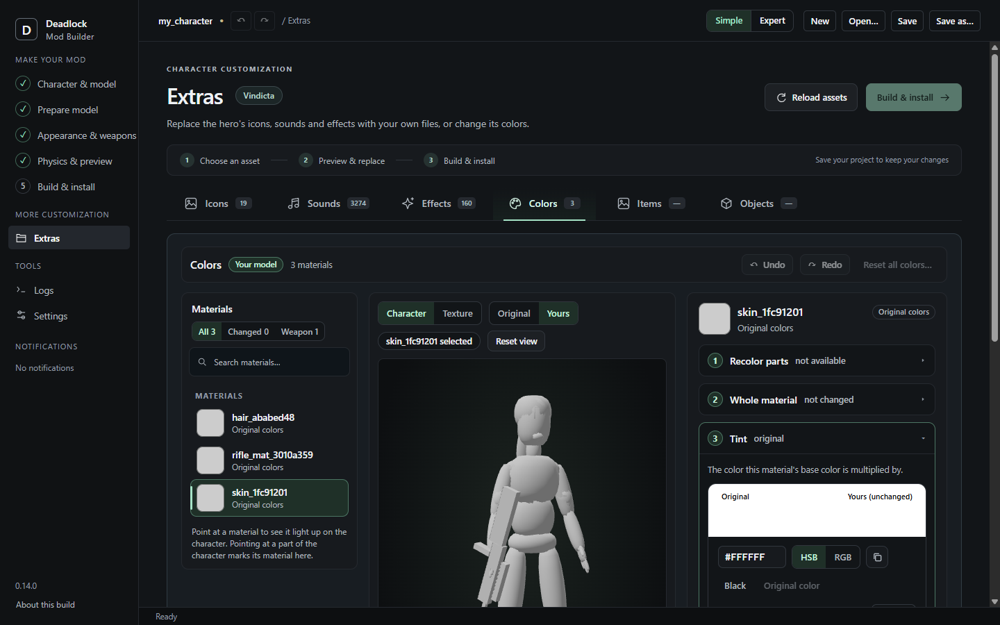

# Model preparation and gun customization

This guide explains how a character file becomes a Deadlock hero replacement. It
covers what each of the five steps does, what the preparation step fixes by
itself so that almost any rigged humanoid works, which choices are yours, and
where the limits are.

## The five steps

The sidebar leads through five numbered steps, and a check mark shows a finished
step. Motion and Extras are optional (see [Motion](MOTION.md), and the Extras
sections from [Hero sounds](#hero-sounds) to [Colors](#colors)); Step timings,
Logs and Settings are tools. Undo, Redo, copying a project to another hero and
the installed-mods list are in [Projects and installed mods](PROJECTS.md).

| Step | What happens |
| --- | --- |
| Setup | Deadlock, Blender, Source 2 Viewer CLI and Reduced CSDK 13 (once, in Settings or the new-user guide). |
| 1. Character & model | Pick the hero model to replace, your model file and, optionally, a gun file. |
| 2. Prepare model | Turn your file into a DMX bound to the hero's exact skeleton. |
| 3. Appearance & weapons | Tabs for materials, face, the gun, and accessories and props; the model, mesh options, texture folder and saved inputs are menus in the top bar. |
| 4. Physics & preview | Secondary motion (hair, cloth, breasts, gun charms) and a 3D view of the prepared character. |
| 5. Build & install | Inspect the project, compile the model and materials, pack the VPK and install it. |

Blender runs in the background as a geometry engine. Your own file is never
written.

### Simple and Expert

The switch in the top bar chooses Simple (the default) or Expert. Simple hides
advanced pages and tools, including the **Body roles** and **Joint matches**
tabs on Prepare model. Those tabs open by themselves when something needs a
choice, and **Edit matches** opens them on request. Required choices, such as unmatched joints,
shape key handling and red tool paths, are never hidden.

### 1. Character & model

The hero picker labels models from the installed game's hero definitions. The
model a hero definition loads is that hero's main target, and roster models the
game does not load are marked *Not used in game*. Each entry has a tag: *In
game*, *Alternate*, *Not playable yet* or *In development*. Analyze warns when a
project targets an *In development* model.

A Blender, FBX, glTF or MMD (.pmx, .pmd) model goes straight to step 2 and is
prepared automatically. A DMX is analysed as it is.

### 2. Prepare model

**Prepare automatically** inspects your file, applies the suggestions, checks
the result, converts it and uses the model in one go, then continues to step 3.
It stops only where a choice is needed. **Prepare model** does the same from the
review tabs: the click counts as your review, and the check runs again right
before converting. Choices that need a new inspection (the gun file, Scene
objects) run it again by themselves. A project that is already prepared, or that
started from a DMX, says so and offers to continue.

Before your model is checked, the page shows the model file, the optional gun
file and the start buttons. After the check, a bar at the top names the file
with its bones, meshes and vertices, and holds four menus: **Model file &
orientation** (the file, the orientation and the start buttons), the
preparation mode, **Scene objects** and **Notes** (the inspection notes and
**Re-detect body mapping**). Anything that needs a look, such as a file without
a skeleton, is shown under the bar. The five tabs (**Body roles**, **Moving
parts**, **Joint matches**, **Gun**, **Fit & review**) each show a short status.

Prepare model has one **3D view**, on the left of every tab, with three modes:
*Your model* (the source file and its own animation), *Joint check* (the
mapping viewer) and *Result* (the converted model). The Result view draws its
grid at the game's floor, not at the model's lowest point.

Once *Joint check* is loaded, the tabs label the character: **Body roles**
labels the joints of the chosen body region (and always the selected one; a
click selects that joint), **Joint matches** labels the selected bone, and
**Moving parts** labels each kept group (a click finds it in the list). The
surface the selected joint's or bone's bone moves lights up, also while a
movement test bends the model; the line under the view says what is lit, or
that the bone moves no part of the model. **Show what it moves** turns this
off.

**Body roles** has one row per joint: the bone in your model (or its X, Y and
Z point for a model without a skeleton) and the bone on the hero, filtered by
body region. **Moving parts** has the switches for keeping moving parts,
automatic motion, breast and butt bones, and the list of detected groups.
**Joint matches** starts with two quick fixes (follow the pelvis, or each
bone's suggested joint, keeping offsets), then the remaining groups, the
filters (*Needs a match*, *Body-following*, *All*), tools to give several
bones one hero bone, and one row per weighted bone. **Fit & review**
groups its choices as **Proportions** (Model fitting), **Feet**, **Legs** (Leg
joints), **Arms & hands** (arm skinning, arm alignment, finger bend, skin
influences) and **Shape keys**; each chip shows the current choice and opens
its group.

Preparation has two phases:

1. **Inspect.** The app copies your file into the project workspace (a `.blend`
   with its textures packed), reads the hero's skeleton and gun from the game
   files, lists your bones, meshes, shape keys, scene objects and gun
   candidates, and proposes a body role and a target for every weighted bone. A
   model that lies down is rotated upright and inspected again.
2. **Convert.** Each source bone is fitted to the hero from the reviewed body
   roles, the vertices are moved into the hero's rest pose, the weights are
   mapped to hero bones, and the result is exported and validated.

### Steps 3 to 5

Steps 3 and 4 are covered in the sections below. In step 3, **Apply gun
changes** prepares the model again in one click. In step 5, Build checks the
compiler's paths before compiling and says whether preparing again or a shorter
CSDK folder fixes a path that is too long.

After **Analyze project**, the list of what still needs a choice (detail
levels, materials, mesh mappings, meshes without skin weights) stays on Build &
install while you work. Choices you make tick their item off; mapping and mesh
results are checked again by the next Build or Analyze. When nothing is left
you can build directly, because the build checks the project again before it
starts. Choosing another model or hero clears the list.

**Installed mods**, lower on Build & install, lists every VPK in the game's
`addons` folder and what it changes; see
[Installed mods](PROJECTS.md#installed-mods).

## What the app handles in awkward source files

### Scene objects

The importer keeps the character and sets everything else aside. **Scene
objects** lists every object with a status and a reason; override any choice
there and inspect again.

| Found in the file | What happens |
| --- | --- |
| Cameras, lights, empties, light probes | Ignored. |
| Curves, text, metaballs, surfaces | Converted to meshes when attached to the character rig; otherwise set aside. |
| Grease pencil, hair curves, volumes, point clouds | Set aside (cannot be exported as character geometry). |
| Objects hidden from rendering or in excluded collections | Set aside. Included again if nothing visible remains. |
| Several characters | The most prominent one is kept; choose another **Character rig** to override. |
| Meshes bound to another rig but touching the character | Frozen at rest and attached to the character. |
| Part rigs of a modular character (separate face or hand rig) | Combined into the character rig. |
| Detached props on their own rig, away from the character | Set aside; keep one to attach it rigidly to the nearest bone. |
| Ground planes, backdrops, far-away props | Set aside. |
| Loose props held by the character | Rigidly attached to the nearest bone (finger and toe bones hand them to the hand or foot). |
| Loose accessories hugging the body | Weights copied from the nearest body surface. |
| Bone-parented or constraint-attached objects | Rigidly weighted to that bone at its rest-pose placement. |
| Subdivision, mirror, solidify and other generative modifiers | Applied. |
| Cloth, soft body, particle and other simulation modifiers | Removed; the rest shape is kept. |
| Mirrored (negative scale) objects | Transform baked into the geometry, normals recomputed. |
| Empty material slots | A placeholder material is assigned. |
| Vertices without bone weights | Copy the nearest weighted vertex. |
| Bone weights but no skeleton (the armature was deleted or not saved with the mesh) | A notice under the top bar of Prepare model and on **Body roles**. The file is prepared as a model without a skeleton: the saved weights are left out and new ones are made from joint positions estimated from the body's shape. Choose a file that includes the skeleton (an FBX or the original model), or add the skeleton back in Blender and save. |
| Collection instances, linked libraries | Made real and local in the workspace copy. |
| Multiple scenes in a `.blend` | The active scene is used. |
| Missing, generated or sequence textures | Warning; the material keeps a flat color. |

When your model has shape keys, **Shape key handling** is a required choice.

### FBX textures and long paths

An FBX brings only the images it names, found by file name below its folder; an
FBX the app cannot read (ASCII or damaged) brings every image there.

When the model names an image that is not there but a file with the same name
and another image extension is (it asks for `Body.tga` or `Body.psd`, and
`Body.jpg` lies beside it), that file is used, and preparation says so: "The
model asks for Body.tga; Body.jpg was used." For an FBX the file is looked for
below the model's folder, for a glTF in the folder the glTF names. When several
such files exist (`Body.jpg` and `Body.png`), none is picked: they are offered
in Materials for you to choose. A JPEG never stands in for an opacity image,
since it has no transparency. An image that cannot be found at all is named in
the preparation's notes.

Blender cannot open a path of 260 characters or more. When a texture of an FBX
or glTF model would get such a path in the workspace, the app places its copy
beside the model, under its own name or, when that is still too long or taken,
under a short name, and Blender uses it; the texture keeps its name in the app.
You do not need to rename anything. Preparation stops only when the model file
itself, a glTF data file (.bin), or even a short name would be too long: choose
a shorter Workspace folder in Settings, for example `C:\DMB`. Images the model
does not use are skipped.

In Blender and MMD models, textures are packed from your own folder, so a
texture path there of 260 characters or more leaves that material with a flat
color: move the model's folder to a shorter path. The app itself has no
260-character limit.

### MikuMikuDance models (.pmx, .pmd)

MMD models can be dropped in or chosen directly, as the character or as a gun
file. They need the free
[MMD Tools](https://extensions.blender.org/add-ons/mmd-tools/) add-on in the
same Blender the app uses: in Blender, open Edit → Preferences → Get
Extensions, search for MMD Tools and click Install. The add-on is not part of
this app. Settings shows under the Blender path whether it is installed for
that Blender.

The app imports the model with the add-on's default settings, the same result
as importing it in Blender with MMD Tools and saving a `.blend` file, and then
prepares it like any other Blender file. The model's textures are found the way
the add-on finds them, next to the model; a texture it cannot find leaves that
material with a flat color. Preparing again later does not need the add-on.

### Bone names and body roles

Bone names are tried first (Mixamo, Unreal, Biped, VRM, MMD, DAZ, Character
Creator, Rigify DEF and common variants). When names are missing, ambiguous or
contradictory, the body is recognised from the shape of the skeleton; skirts or
hair that reach the floor are not taken for legs. Left and right come from side
tokens in the names (`.L`, `_l`, `Left`, `lShldr`, `左` and so on) when they
agree, otherwise from the direction the toes point. An MMD rig with every bone
renamed `node0` to `nodeN` is recognised the same as its named version. Your
choices in **Body roles** always win.

### Joint matches

Every other weighted bone follows its body joint (or the nearest one), so
helper, face or accessory bones never block a conversion. Hair, skirts and tails
detected as moving parts stay independent bones when **Moving parts** is on.
Everything stays editable in **Joint matches**, and the review confirmation
covers the loss of independent motion.

## Fitting choices

### Model fitting

**Model fitting** offers *Match hero proportions* and *Preserve source
proportions*. A model checked for the first time in a project starts on the
fit chosen in Settings → Appearance → **Default fit for new models**
(*Preserve source proportions* unless you change it); a project checked before
keeps its own fit. Shiv (a long right forearm) and Wraith (short legs) have unusual
proportions, and preparation warns about them. For such heroes, Preserve source
proportions scales the torso evenly so the hips and neck land on the hero's, and
the legs follow the hero's leg joints. With **Align arms to hero joints**, the
elbow may sit up to 8% of the arm's length from the hero's elbow, and the hand
still lands on the hero's hand. Other heroes are unchanged.

### Bend fingers like the hero

**Bend fingers like the hero** (Fit & review → Arms & hands, on by default) bends mapped
finger segments to the hero's resting direction, so they close around the gun. A
segment that would turn more than 100° is left as it is and reported (a finger
mapped to the wrong hero finger).

### Feet on the floor

Both fits line up your character's ankles with the hero's, and the hero's soles
stand at the game's floor. Feet taller than the hero's (heels, thick soles)
therefore reach below the floor. **Feet on the floor** (Fit & review → Feet) chooses
the correction:

- **Line up the ankles (default):** nothing changes. The receipt notes how far
  the feet reach below or above the floor.
- **Shorten or lengthen the legs:** everything below the hips scales vertically
  about the hips. The hips, body and arms stay on the hero's joints, but your
  model's knees and ankles move off the hero's.
- **Move the whole character up or down:** nothing is stretched, but the body,
  arms and hands sit that much off the hero's joints (and the gun).

Moving parts kept on a scaled leg stay rigid and follow their attachment point.
Within 0.05 in nothing is corrected. A scale outside 0.2 to 3 leaves the fit
alone with a note. Changing this choice needs a new conversion.

### Leg joints

With *Preserve source proportions* the body is placed by your model's pelvis
bone. When that bone sits away from the hip joints, or the legs are longer or
shorter than the hero's, the model's hips, knees and ankles end up off the
hero's joints, and the knees stretch in deep bends (jumping, crouching).
**Leg joints** (Fit & review → Legs), offered with Preserve source proportions,
chooses how to deal with that:

- **As before (default):** the body is placed by the pelvis bone.
- **Hip joints, and legs on the hero's joints (no resizing), recommended if
  the knees stretch:** the body is placed and turned by its hips, and the
  hips, knees and ankles sit exactly on the hero's. Thighs and shins are
  lengthened or shortened to the hero's; their thickness and the rest of the
  character keep their size.
- **Place the body by the hip joints:** only the placement changes. Nothing is
  resized, so legs longer or shorter than the hero's still leave the knees a
  little off.
- **Hip joints, and resize the character to the hero's leg length:** the whole
  character is also scaled evenly so its legs are as long as the hero's. It
  becomes smaller or larger by that ratio.
- **Hip joints, resize, and legs on the hero's joints:** resized as above,
  with the legs on the hero's joints.

The two choices that resize the character can stretch the shoulders while the
arms are aligned to the hero's joints; try them only when the others do not
suit your character.

The more the legs follow the hero, the more the upper body moves relative to
the hero's skeleton, so the hands and head sit a little differently. After
preparing, the page shows how far the knees sit from the hero's knee joints,
the stretch that gives in a 90° bend, and the character's size. The two
choices that put the legs on the hero's joints cannot be combined with Feet on
the floor → Shorten or lengthen the legs. Heroes with unusual proportions keep
their own fit. Changing this choice needs a new conversion.

## Materials and textures

### How base colors are found

Each material's base color comes from its node graph: the image feeding the
Principled BSDF base color, or, in game rips, an image wired straight into the
Material Output or into a Diffuse, Emission or Toon color. A material with a
single unsuffixed image uses it as the base color. Channel suffixes (`_n`,
`_nrm`, `_orm`, `_mask` and so on) choose the other slots.

A texture connected to the base color is not tinted: the material gets a white
tint, because Blender ignores the color behind a connected socket. Materials
without a base-color image keep their color.

An FBX or glTF material the model links no image to can take one by its file
name: an image below the model's folder whose name, without prefixes such as
`T_` and base-color endings such as `_D`, `_BaseColor` or `_Albedo`, is the
material's name without `MI_`, `M_` or `Mat_` (also when both names start with
the model's own name, as in `MI_Hair` and `T_Model_Hair.png`). Images with
other endings (`_N`, `_M`, `_Mask` ...) are never taken. The image is used only
when it is the one image that fits that material and fits no other one;
otherwise, and when the image the model links is missing, the fits are offered
in Materials. Only base colors are matched this way, and such a pick, like
every automatic pick, waits for your review in Materials.

The game textures with the first UV map, so the UV map a part's materials
actually use is moved to the front before export. Baked atlases often live on a
second map such as `BakeUV`.

### MMD materials

MMD materials feed a base texture, a toon ramp and a sphere (shine) map into the
MMD shader. The toon ramp and the sphere map are never used as the color, and
such materials carry a review note that toon effects are not baked.

### Face details

A material the source shows fully transparent is a layer that an expression
fades in: blush, tears or other (sweat, effect quads). A game build has no
expressions, so these layers are hidden by default. **Appearance → Face →
Face details** shows them by kind (Hidden or Shown). A shown layer uses its color image's alpha as its
transparency, so the blush keeps its soft edges; an image without transparency
is drawn as it is. Switching a layer needs no new preparation; finding the
layers does.

### Preparing the same hero again

A material keeps what you changed. A texture or tint that is still the previous
preparation's automatic pick takes the new automatic pick.

### Material names

A prepared material's file name keeps at most 24 readable characters of the
Blender material name plus an 8-digit code from the full name, because Windows
tools fail on paths of 260 characters or more. Your material choices carry over
when a model prepared with longer names is prepared again. Non-English names are
spelled in Latin letters, so `头发` becomes `toufa_…` instead of `__…`. ASCII
names keep exactly the name they had. Bone names are not changed.

## Mesh mapping

Mesh mapping is on the Build page. Every source mesh is a checkbox under each of
the original model's render nodes. Prepared characters name their meshes after
your source (Body, Face), not after the hero's render nodes, so the page offers
a **suggested mapping**: all your meshes on the main body node and its lower
detail levels (also when only some of your meshes are named like the hero's
parts), the original's other parts hidden, and its weapon parts (whatever they
are named) and the things the hero carries (a turret being placed, a canister
in the hand) kept. Nothing is applied until you click **Apply suggested
mapping**. Source meshes that no render node uses are named in
a warning (and by Analyze), because they would be missing in game, with a button
that adds them to the main node.

## Moving parts

### What counts as a moving part

A bone chain becomes a selectable moving part when it has existing physics
bindings, when it has a recognisable name (hair, ponytail, braid, ribbon, skirt,
cape, tail, robe, sash, scarf, shawl, mantle, cloak, tassel, veil, and Japanese
and Chinese equivalents), or when it is a long unnamed chain: at least three
weighted bones in a single line, hanging from the pelvis, spine, chest, neck or
head, spanning a quarter of the torso. Fingers and toes never qualify.

New models keep every detected group. In projects with automatic motion, groups
detected for the first time are added, and groups you were shown and left off
stay off.

### Part types

Build gives each moving part a type. You can change it under **Adjust moving
parts**; an explicit choice always wins.

- **Hair.** Named hair, unnamed strands on the head, and braids (including
  "plait"). Every strand has a limit on how far it can swing from its place
  and how high it can rise, so hair no longer floats up during a long fall.
  The root of each strand stays on the head and the next two joints stay
  close to it (firmer, and no further from their place than their distance
  to the body), so the head does not show through the hair when the
  character moves; the rest of the strand swings freely. Hair has no drag.
  Short hair (up to half a torso length) has light gravity (a third of
  normal) below its root, so it settles downward; tiny strands and tufts
  (under an eighth of a torso length) have none, and longer hair moves as
  before: no gravity, until hair longer than 2.5 torso lengths gains gravity
  and drag and hangs like a streamer from 3. Hair buns (one round
  piece on one bone, or named bun, 団子, 丸子, 髻 or odango) are Rigid and follow the
  head.
- **Tail.** Named tails, and unnamed long, round strands on the hips (four or
  more weighted bones, not flat, not joined to other parts). A tail modelled
  level and straight past its base (as MMD models often are) hangs under
  gravity: its hold fades toward the tip and its travel allows a full hang.
- **Ear.** Ear groups. On ears with three or more weighted joints, the base of
  the ear stays on the head (its first joint moves only a tiny amount, and
  Swing range does not change that) and the rest of the ear is a little firmer
  than hair, so it wobbles and sways without flopping. The **Ear motion** switch (Physics & preview → Fine-tune) turns them off
  (anything hanging from them stays still too) and back to automatic.
- **Streamer.** Ribbons, tassels, cords and long thin strips. A sleeve named
  sleeve or 袖 on one thin, flat chain of at least 6 weighted joints is a
  streamer. Streamers can bend and swing freely but do not stretch or fold up.
  Streamers with more than 10 weighted joints get less drag.
- **Cloth.** Panels, for example a cloak. Long strips that hang from a cloak or
  cape (at least 0.6 torso lengths, at least twice as long as wide) move like
  streamers while the shared top keeps cloth values.
- **Long skirt.** A panel that reaches 0.45 torso lengths below the pelvis and
  spans 0.6. A shorter panel (reaching 0.4, spanning 0.5) joins the skirt when
  it shares mesh with it, panel by panel. Each skirt joint's travel is capped by
  the gap between its fabric and the body.
- **Charm.** Names with charm, keychain, keyring, pendant, lanyard or dangle
  (and Japanese and Chinese equivalents) move wherever they hang. A charm word
  beats the rigid accessory words, so a dangle earring moves.
- **Rigid.** Halo, hat, cap, crown, tiara, horn, helmet, glasses, mask, earring,
  hairpin, clip, hair band, ornament and accessory (also 飾, 冠, 帽, 角, 眼鏡, 輪)
  never become moving parts from their names, so `HairPin` or `髪飾り` stay on the
  head. Other motion words still win: a ribbon on a hat moves. Rigid parts are
  not simulated; they follow their bone. A model whose every part is Rigid is
  refused with a message to turn movement off.
- **Breast** and **Butt.** See [Breast and butt
  motion](#breast-and-butt-motion).

Strands with more than 6 weighted bones move like a 5 to 6 bone strand.

### Body colliders

With automatic motion, Analyze measures capsules on the character's own thighs,
shins, upper arms, forearms, hips, neck and head, so skirts, coat tails, capes
and tails stop at the body. Shoulders and upper back have none. Colliders act on
the part's joint line, not on the visible panel around it. Strips anchored on an
arm track the arm closely.

### Breast and butt motion

Breast motion and butt motion are separate options, and both are off for new
models.

- **In preparation:** **Keep or add breast bones** decides whether breast bones
  are in the converted model, and **Keep butt bones** does the same for butt
  bones. If the rig has no breast bones, the app adds a left and a right one
  under the chest when the chest clearly has breasts that mirror each other;
  flat, male and child chests and asymmetric clothing get none, and the receipt
  says why. A rig that already has weighted breast-named bones never gets extra
  bones. Breast names in Chinese pinyin count too (for example `Xiongbu.L`,
  `Xiong_R`, `RuFang_L`), also when each breast bone carries a base bone and a
  ring of surface bones; such a breast is kept as one breast part.
- **On Physics & preview → Fine-tune:** the **Breast motion** and **Butt motion** switches
  decide whether those parts move, with one amount control for both sides.
  Turning a switch off makes the parts Rigid but leaves them in the model. This
  needs no new conversion. Breast bones from a rig's own physics count even when
  the preparation option is off.
- **Breast motion:** a slow, soft bounce that lags the body and settles. Each
  breast is held only by its pull back to the pose, its damping and its travel
  limit: it is not tied to the chest or to the other breast, and the body
  colliders (arms, legs, hips) do not push it. **Stiffer** and **More
  movement** change the pull, damping and reach, and the Fine-tune sliders
  adjust from there. The travel never reaches the other breast, even with
  Swing range turned up.
- **Butt motion:** a short bounce, with the two sides moving together.
  **Stiffer** and **More movement** reduce or increase it.

A breast-named bone that carries a long part (more than half a torso, such as a
cape) moves as that part instead. The Breast motion switch leaves such groups
out and says why; choosing Breast for them on the **Moving parts** tab still
works.

### Source rig springs

Inspect reads the spring settings a rig already has: VRM spring bones (from a
`.blend` or from a `.vrm`, `.glb` or `.gltf` file; the VRM add-on is not needed)
and MMD rigid bodies. They are converted to the app's scale and used only when
**Start from your model's own MMD spring settings** (or VRM) on the
**Moving parts** tab is on. It is off by default.

## Fine-tune and the movement preview

### Fine-tune movement

Physics & preview has four tabs beside the character preview: **Physics mode**,
**Fine-tune**, **Moving parts** and **Tested cloth setup**. Fine-tune and Moving
parts apply to **Automatic secondary motion**; in the other modes they say so
and offer to switch. On **Fine-tune**, pick a part type found in the model (hair,
streamers, tails, ears, cloth, long skirts, accessories, breasts, butt, gun
charms) to see its four sliders. Each runs from −100% to +100%, and the middle
is the automatic value. Drag in 5% steps, type an exact percentage in the box,
or click **Automatic** under a slider to put it back. A dot marks a part type
you changed. Breasts, butt, ears and gun charms also have their on/off switch
here; a type that is switched off keeps its place in the list, marked Off.
After an Analyze, the preview labels each part type on the character; click a
label to open that type (on the Moving parts tab, it marks the type's first
part). **Moving parts** lists every kept moving part with its part type and
Movement choice, with a filter for the parts you changed and a search.

| Slider | Effect |
| --- | --- |
| Stiffness | Moves the pull back to the pose up toward full or down to a quarter. |
| Damping | Moves damping up toward 0.5 or down to none. |
| Gravity | Moves gravity up toward 1.5 or down to none. |
| Swing range | Scales the travel limit between ×0.25 and ×2.5. A part that swings freely stays free. The root of a hair strand or ear that stays on the head is not changed, and the two hair joints below it can swing less but not further. |

The per-part Movement choice (**Stiffer**, **More movement**) is applied first.
The preset, **Saved presets**, **Save as preset** and **Reset all** sit in the
bar at the top of the page. **Reset all** puts every slider back to automatic. Before the first Analyze,
every common part type is listed.

The sliders are keyed by part type, not by moving part, so a saved preset fits
any model. **Saved presets** hold only the tuning (up to 50, names up to 40
characters), and applying one replaces the project's tuning. The TangTang
presets ignore tuning.

### Movement preview

**Movement**, in the bar above the character preview, plays the hero's own
clips on your prepared character at 1×, 0.75×, 0.5× or 0.25× and moves the
moving parts with your Fine-tune values. The motions are **Stand**, **Run**,
**Back**, **Left**, **Right** (running backwards and to each side), **Stop**,
**Jump** and **Fall** (a long fall). The runs use the hero's own speeds and the
hero's own forward, backward and sideways lean, and the jump travels through
the air; the floor is hidden during a fall.

With **Automatic secondary motion**, Movement simulates the game's own cloth
model: the same points, links, limits and body colliders the game uses for
hair, cloth, tails and the other moving parts. They trail and settle much
closer to what you see in game than a simple swing, and a Fine-tune change
shows at once. The simulation comes from the last **Analyze project**; for a
project analyzed with an earlier version, or when that data cannot be read,
the parts swing by a simple approximation and a line under the view offers
**Analyze again**. The preview is still for tuning by eye: look at the
character in a match too.

Switching **Moving parts** on or off redraws the view at once, also while it is
paused. The line above the Fine-tune sliders and the Moving parts list says when
the sliders cannot be seen working (for example while the view is on Still) and
offers the button that fixes it: **Show my character**, **See it move** (which
analyzes first when needed) or **Go to Build & install**.

Both views of the preview show the colours of your assigned base-color images,
with your colour edits; face details that are switched off are not drawn.
**Solid** turns the textures off. The game's lighting, shaders and normal maps
are not part of the preview.

## Guns

Deadlock heroes carry their gun in one of three ways:

- **Part of the hero model:** render meshes skinned to weapon bones. The app
  finds them in the hero model together with their lower detail levels.
- **A gun in each hand** (Haze): every gun mesh is weighted to one hand's bones,
  and each hand's gun is measured on its own.
- **A separate weapon model:** the hero model has no gun mesh; the gun is its
  own `.vmdl`.

### The Gun tab

The Gun tab summarises the hero's gun, your gun and what will happen, then
offers one choice as three cards:

| Choice | Result |
| --- | --- |
| Use my gun(s) instead of the hero's (recommended, preselected) | Your gun is fitted onto the original and replaces its meshes (all detail levels) in the mesh mapping. |
| Keep the hero's gun(s) | Your gun is left out of the character. |
| Keep my gun in the hand as an accessory | It follows the hand like any accessory, and the hero's gun stays too. |

While your gun replaces the hero's, the fit preview with its adjust buttons
takes the place of the page's 3D view, and the settings sit beside it. The Gun
tab of Appearance & weapons shows the same panel.

For a dual-wield hero, **Right hand** and **Left hand** pick your gun for each.
The left hand can also use *A copy of the right-hand gun* or keep the hero's own
left gun. **Swap hands** exchanges the two with their adjustments.

### Fit preview and adjustments

A 3D preview updates by itself after every change: your right gun in amber, your
left gun teal, the hero's guns see-through, and arrows along the line of fire.
View buttons (Angled, Front, Side, Top) and Show buttons (the hand, **Both
guns**, **Whole body**) frame it.

**Pose: Holding / Rest** (Holding by default) shows the hero as it holds the gun
in game. The fit itself is measured in the rest pose.

The adjust buttons (**Flip direction**, **Turn ⟲ 90°** and **Turn ⟳ 90°**,
**Smaller**/**Bigger**, Back/Forward/Up/Down/Left/Right, **Reset**) change the
selected hand. **Both guns** moves a dual-wield hero's two guns together. Roll
turns the gun around its barrel; pitch tilts the muzzle up and yaw turns it to
the gun's right, both around the grip. **Advanced gun settings** holds size
mode, skinning, the weapon bone, exact numbers per hand, the parts list and
**Join each gun's parts into one mesh**.

### How the fit works

Both guns are measured the same way: barrel axis, muzzle end, up direction, grip
and length. Part names count as whole words: Muzzle, Barrel, Nose, Front,
Emitter, Suppressor, Silencer and Compensator for the front; Rear, Back, Stock
and Butt for the rear; Grip, Handle and Handgrip for the grip. The fit line
shows how the front was found. **Flip direction** moves the muzzle to the other
end, and the app points out a flip that goes against the part names.

Your gun is rotated to match the original, scaled to its length (or kept at the
character's scale) and moved so the grips coincide. It takes the original gun's
skin weights, so it follows the same weapon bones (recoil, slide, magazine).
Muzzle attachments and hit detection stay on the original bones. Heroes without
gun meshes but with weapon or muzzle bones use those bones for the fit with
lower confidence; check the roll in the preview.

**Join each gun's parts into one mesh** is on by default; parts with shape keys
are left as they are. Gun parts that use identical materials share one game
material, so a gun baked to one atlas becomes one material instead of one per
part color.

### Gun from another file

The Gun tab of a character project, and step 1, offer an optional **Gun from
another file** (Blender, FBX, GLB, glTF or MMD .pmx/.pmd). Choosing, changing or clearing it
runs the inspection again by itself.

- Hidden objects, the gun's own rig, ground planes, backdrops and parts away
  from the gun are set aside, and each can be kept in **Scene objects**. Flat
  gun parts such as grip panels, rims or decals are never taken for the floor.
- The gun's grip is moved to the middle of the right hand unless the gun already
  sits there, and the gun is weighted rigidly to the hand. A rig without a right
  hand attaches it to the nearest weighted bone; an unrigged character keeps it
  where it is.
- **A pair of guns** in one file gives a right and a left gun. Parts are sorted
  by their hand from the object name (tags `[L]`/`[R]`, `(L)`, `.L`, `_R`, then
  the words left/right, l/r, 左/右) or from the gun rig bone they are weighted to.
  Mirrored halves of one gun stay one gun. A real pair posed overlapping in the
  file is taken for one gun; set one side aside in **Scene objects** to split
  it.
- Guns from the gun file are suggested before any gun in the character file. A
  gun-file gun that no hand uses is left out. A gun in the character file stays
  on the character unless you set it aside in **Scene objects**.
- Charm chains on the gun file's rig keep their bones and hang from the hand
  holding that gun, so they swing like charms on the character's own gun.
- A changed, cleared or newly chosen gun file needs a new inspection. A moved
  but identical file is accepted.

### Separate weapon models

When the hero's gun is a separate model, the Gun tab's **Use my gun instead
of the hero's** creates a gun project next to your project, prepares the gun and
links it, so one VPK holds the character and the gun. The same preview and
adjust buttons work on the gun project, and **Apply changes** makes the gun
model again. **Appearance → Gun → Weapon model** (*Find this hero's weapon
models*, *Create weapon project*) remains for manual setups.

A weapon project's source may be a gun-only file. When no object is recognisable
as a gun (one unnamed, unrigged object such as `Cube`), the whole scene except
ground planes and backdrops is offered as the gun. Without a rig, parts touching
each other in a chain (barrel, suppressor) stay together.

### Charms on the gun

A chain hanging from a gun bone counts as a gun charm when it has two to four
bones in one line, its tip hangs below its top by at least 40% of its length,
and no bone in it is named as a gun part (slide, magazine, trigger, barrel and
so on). A strap hanging from a gun bone counts in any shape. A charm made of one
weighted bone has nothing to swing around and stays rigid. A chain hanging
straight from the hand bone is not a gun charm unless it is named as a charm.

| Gun choice | Charm |
| --- | --- |
| Replace the hero's gun | The charm's bones are kept, hang from the hero bone the fitted gun follows, and are placed like the gun. |
| Keep it in the hand | The charm hangs from the hand like any accessory. |
| Leave it out | The charm is left out with the gun, and offered again when the gun comes back. |

A charm's pivot stays on the gun and the rest swings with no gravity, so it
never sags into the gun when the gun is held sideways. The **Gun
charm motion** switch (Physics & preview → Fine-tune) turns the swing on or off (off keeps the charm still on
the gun) and sets one amount for all charms, without converting again. A gun
that copies the right-hand gun keeps the copied charm rigid.

Separate weapon models cannot carry charm motion. A gun from a separate gun file
keeps its charm bones when it replaces a gun that is part of the hero model.

## Hero sounds

**Extras → Sounds** is not part of preparation. It lists the hero's sounds with
tags: Hero (in the hero's own folders), Ability, Weapon and Voice. A sound can
carry several: a line said when using an ability is Hero, Ability and Voice.
Choosing several tags shows the sounds that have all of them. With Voice
chosen, voice lines can be narrowed to pings, emotes and efforts, ability
lines, match start, kills, hero select and lines other heroes say about this
hero. Lines other heroes say, and sounds other heroes also use, are marked
Shared and need **Include this shared replacement** before they are built.

To replace a sound, select it, listen to the original, and drop a WAV, MP3,
FLAC or OGG file on the right or browse for one. **Include in build** keeps it
in the next build. Numbered copies of one sound are one row. Choose a variation
to replace it on its own, or use **Replace all N variations with one file**;
the page says which variations it could not set and why.

A sound can also be silenced: **Silence this sound** needs no file, and the
game then plays nothing for it (for example the cast sounds of an ability whose
main sound you replaced with a song). **Silence all N variations** does the
same for every variation. A silenced sound keeps its game length and loop
points, counts as a change like a replacement, and follows the same rules for
shared sounds and the 128 sounds per project.

### The sound editor

The game fixes the length of each of its sounds (and the loop points of a
looping one), so a replacement is always exactly that long. Without an edit,
**Sound timing** and the volume on the side panel decide how your file fills
that length (pad shorter audio, allow trimming longer audio, or the exact
source length). The editor lets you choose which part of a longer file plays;
a shorter file is followed by silence. Once a sound has a file, **Edit the
part, volume and fades** opens the editor; a file too long for the side
panel's timing shows **Choose the part that plays** instead. The editor opens songs and other long files, up
to 20 minutes.

- **Your file** shows its waveform with a frame as long as the game's sound.
  Drag the frame, or use **Starts at**, to choose the part that plays. Below it,
  *What the game will play* shows the result with your volume and fades, and
  the game's sound is drawn for comparison.
- **▶ The game's** and **▶ Yours** play the two; yours is exactly what the
  build writes, and changes are heard right away.
- **Volume** makes the part louder or quieter, in dB. **Match the game's
  loudness** sets it so the part that plays is about as loud as the game's
  sound. The volume never clips: when louder would clip, the loudest peak is
  held just below full scale and the page says so.
- **Fade in** and **Fade out** give a soft start and end. A fade longer than
  the part that plays is held to it. A looping sound has no fade out (it would
  dip on every loop), and its fade in ends where the loop starts.
- **Replace all N variations with this part** gives every variation the same
  file with the same start, volume and fades. **Reset edits** removes the edit,
  and **Back to sounds** returns to the list.

The edit is kept in the project; your file is not changed.

## Hero effects

**Extras → Effects** lists the hero's ability and weapon effects, grouped by
ability. An effect is made of parts, and each part shows the game's colors with
yours below them. An effect that is in its group only because of its file name
says "Grouped by its file name", so a wrong guess is easy to spot. Files the
game's data does not link to anything stay folded under "Other files". The
page has two views: **Edit colors** (below) and **Replace a file**.

In **Simple**, click a color (for example neon purple) or pick any color: the
effect's main color becomes it and the other colors follow. If the detected
main color is wrong, choose another with **Not the main color?**. **Advanced**
adds exact hue, saturation and brightness, a tick per part to keep that part's
game colors, and a color of its own for any single color of the effect.

**Size**, **Brightness** and **Opacity** change every flat or glowing part of
the effect and say how many parts they reach. On 3D models they change only a
size or opacity the part's file already sets; ground decals and lights are not
reached, and some parts have a size limit set by the game. Parts that keep
their own colors, such as ground decals and some 3D models, say so ("This part
keeps its own colors").

### Advanced: settings per part

In **Advanced**, each part says what it draws (*Line*, *Glow sprites*,
*Trail*, *3D model*, *Light*, or several of them) and how it follows your
colors:

- **Shown / Hidden** hides a part: it is not drawn, the rest of the effect is
  unchanged, and the parts below it keep working.
- **This part**, on a 3D model, holds its own **Size** and **Opacity**, which
  multiply on top of the effect-wide sliders (those reach a 3D model only where
  its file already sets the value). When the game's file gives
  the model no color of its own, it also offers a **Tint** that colors the
  whole object on top of the material the game draws it with. **Reset this
  part** clears them. A 3D model that may not follow your colors says so
  (*May keep its colors*).
- A part with its tick cleared keeps the game's look entirely: its colors,
  size, brightness and opacity.
- Lights take the effect's colors when you recolor it. **This part**, on a
  light, holds **Light brightness**: how strongly the light shines on the
  floor and walls around it, from 0 to 50 times the game's value. At 0 the
  light is dimmer but may not go out; hide the part to remove it. Some lights
  cannot be changed (the game sets their brightness while the effect plays,
  or their file holds no brightness value), and the part says so. The moving
  preview does not show light brightness.

Speed and duration of an effect cannot be changed.

### The moving preview

The effect you select plays above **Parts and their colors**. What you see as
yours is made from exactly the files the build will write, including parts
that another edited effect or your own replacement file decides, and it updates
while you drag a control. **Speed** and **Loop** change only the preview.
Switch on **Compare with the game effect** to see the game's version beside
yours, in step. Drag the picture to turn it and scroll to zoom. Background,
view brightness and frame rate only change the preview, never the mod; the
frame rate you choose is remembered. The preview is approximate: there is no
map lighting, the effect is not attached to the hero, and some parts (lights,
effects placed on a character, screen effects) cannot be shown; the page says
so under the picture. The player needs OpenGL 4.6; without it the page shows
the color strips alone and everything else works.

### Shared effects and replacing a file

An effect the game also uses elsewhere says so under **Also used by**: your
change shows there too.
Parts of an effect that other heroes also use, such as the default
bullet-impact debris, keep the game's look unless you tick them in Advanced;
ticking one changes it for those heroes too.
When two edited effects share a part, the effect that comes first decides that
part. **Replace a file** swaps one effect file for your own compiled `.vpcf_c`
as before, and your own file wins for that part.

## Item icons

**Extras → Items** lists the game's items from the game's own files: each
item's name, category, tier and price come from the installed game, so the page
follows game updates. Pick a category (Weapon, Vitality, Spirit, Legendary or
Misc), find the item in its tier row or search for it, and drop a PNG or JPG on
the right; square pictures work best. The icon editor's choices apply: fit
inside, fill and crop, or stretch, **Include in build** and **Remove
replacement**. Legendary holds the Street Brawl items; those the game has
switched off are greyed out at the end and can still get an icon, ready in case
they come back. Misc holds the game's other item pictures, such as seasonal
ones, and is hidden when there are none. Nothing about items is read until you
open the page.

Item icons are the same for every hero, so a replacement shows for all heroes
while the mod is installed. An item icon can be built on its own (without a
replacement model) or together with a model and other extras. If two installed
mods replace the same item icon, the game shows only one of them.

### Item names

The same page renames an item. Select the item: its name is a field at the top
of the panel on the right. Type the new name (up to 32 characters; the counter
shows how many) and click **Save** or press Enter; **Cancel** or Esc drops what
you typed. **Use the game's name** takes the rename off again. A renamed item
shows its new name in the list (its tooltip also gives the game's name), the
panel shows the game's name under the field, and the search finds it by either
name.

In the game, the item's card and tooltip title show the new name, the shop's
search finds it by the new name and by the game's own search words, and the
effect name shown while the item is working follows the new name too. The
description under the title stays the game's text, and so do voice lines and
other texts that spell an item's name out.

Good to know:

- Renamed items are the same for every hero while the mod is installed.
- The shop sorts each tier's items by name, so a renamed item moves.
- The game takes a mod's item name list in place of its own. The build
  therefore writes the game's whole list, in every language the game supports,
  with only your names changed. After a game update that adds or renames
  items, build the mod again: until then the new items show without a name.
  The app does not install a list made from an older game version, and
  **Build & install → Installed mods** says when an installed list is missing
  names the game now has.
- Only one installed mod can carry the item name list. If two do, the game
  uses one of them.

## Ability objects

**Extras → Objects** replaces an object that one of the hero's abilities
throws, shows or places (for example Haze's Sleep Dagger, Kelvin's Frost
Grenade or Holliday's Powder Keg) with a model of your own. It needs Blender
(to prepare your file) and Reduced CSDK 13 (to compile it), both set in
Settings, with the model compiler left on Auto.

The list is read from your game the first time the tab opens, with the hero's
objects grouped under their abilities. Two kinds can be replaced: objects an
effect draws, and objects the game places itself. Some of them have collision,
hit areas, attachment points, several materials, a glowing outline, versions
an effect switches between, or moving parts the game animates. Every object of
the hero's abilities is listed, and one that cannot be replaced yet says why
and is marked **Not offered yet** (a few objects whose cloth, skeleton or
parts a rebuild cannot keep as the game has them). A
model the game never draws is not offered either: some abilities use a model
only to block players, shots or sight, and what you see there is an effect
(Kelvin's Frozen Shelter dome is one), so a replacement would not show.
Plain shapes that many heroes share are never listed, because changing one
would change most of the game.

1. Pick an object in the list (**All**, or **Replaced** for the ones you
   changed) and click **Show this object**. The first time, the app reads the
   game's object from your game; that takes a moment.
2. Under **Your object**, **Choose file…** takes a `.blend`, `.fbx`, `.glb` or
   `.gltf` file with one object; it needs no skeleton. The app prepares it with
   Blender, and **Change file…** or **Prepare it again** do the same after you
   change the file.
3. Under **Fit**, choose the **Size**: **Match the game's object** (your
   model's longest side is laid along the game object's and scaled to its
   length) or **Keep my size**. **Adjust size** scales it further, in percent.
   For an object that stands on the ground, **Stands on** chooses **Centred on
   the game's** or **The game's base**. The **Turn** buttons (**Roll 90°**,
   **Tip up 90°**, **Turn round 90°**) turn it in quarter turns; **Reset**
   undoes the turns.
4. Leave **Include in build** on and build as usual (**Open Build & install**).
   Object replacements also build without a replacement model.

For an object the game animates (for example McGinnis's healing canister),
**How your model moves** chooses how your model follows the game object's
moving parts:

- **In one piece**: the whole model follows the object's main part. Nothing
  inside it moves.
- **By parts**: each separate object in your file follows one of the game
  object's moving parts. Under **Your parts** the app suggests a part for each
  of them, and you can change it.
- **My model has the same skeleton**: for a model you rigged on the object's
  own bones.

The animations stay the game's. The panel lists them, and the view can play
them on your model before you build. Some objects are animated in an older
way, without an animation graph (for example Venator's Snap Trap): the build keeps
the game's own animations for them unchanged, and when the view cannot play
those it says so and shows your model at rest.

The **Object view** shows **The game's** object as a dashed outline, **Yours**
fitted as it will be built, or **Both**. For an object with collision, the
game's collision (what blocks players and bullets) is drawn as amber dashes
(**Collision shown**), and the panel says how far your object sticks out of
it: keep your object close to it, or players are stopped by something they
cannot see. Custom-shaped collision (for example Viscous's Cube) is kept
exactly as the game has it and drawn as a box around it, not as its exact
shape; for a few such objects the view cannot draw the collision at all.

What changes is the object's shape and, usually, its look. **Stays the game's**
lists what the replacement keeps: when the object appears, how it moves and
what it hits, its trail and the effects around it, and, for the kinds that
have them, its collision, hit areas, attachment points and glowing outline.
Some models hold a second part that shows beside the object: your model
replaces the object, and the list names the part that stays the game's own
(McGinnis's Mini Turret keeps its range markers). The same goes for an object
made of several pieces that show together (Doorman's door): your model
replaces the first piece and the other pieces stay the game's own. An object
whose shape the game changes while its animation plays (Kelvin's ice path,
Viscous's Puddle Punch) shows your model in its own shape throughout. An
object with cloth of its own (Rem's helper, Calico's cat form, Sinclair's
assistant) keeps the game's cloth: the parts
of your model that follow the bones the cloth moves swing like cloth, and the
rest of it does not. An object that breaks apart
when destroyed (for example Solomon's bishop) still breaks into the game's own
pieces, not into pieces of your model. An object with a glow around it
(Pocket's briefcase) keeps the glow: the app makes it from your model, a
little larger, in the game's own glow material. An object the game shows in
several states (Graves's gravestone, whole and cracked) shows your model in
every state; for such an object the app picks what your model follows in each
state, so **How your model moves** offers the ways without a bone to choose.
Your model's own colors and images show in game unless an effect draws the
object in a material of its own: the page then says that only your shape shows,
or that your colors show only in the effects that do not override the
material. The same goes for an object an effect draws in one of the game's own
looks of it (McGinnis's wall while it is being placed shows in the game's
see-through preview look): the page says so, and your shape shows there
without your colors.

A few objects are not named anywhere in the game's data, because the game
places them itself. The app lists such a model when it sits beside a listed
object and is named after it, and the panel says **Found by its file name**.
McGinnis's Spectral Wall is the example: the wall while it travels and the
wall as it stands are two models, listed separately, and replacing both
changes the whole wall.

The game uses some objects for more than one hero. The panel then says **Also
used by** those heroes: they show your object too, because the game uses one
file for all of them. A few objects are models from the game's scenery that
an ability's effect also draws (a rock, a beam, a tombstone); the panel then
says the model is part of the game's scenery, and if the map uses it too,
your object shows there as well. A project holds up to 32 object replacements. **Remove**
takes one off, and **Remove all replacements…** clears them all; your files
stay where they are.

## Colors

*Extras → Colors: your model's materials, the character in 3D, and the three editing steps for the selected material.*

**Extras → Colors** is not part of preparation. It lists the materials on the
left, shows the character in 3D in the middle (or a material's base color on
the Texture tab), and edits the selected material on the right. Click a part of
the character to choose its material. Point at a material in the list and it
lights up on the character; point at a part of the character and its row is
marked in the list. The **Weapon** filter, beside **All** and **Changed** at the top of the
list, shows only the
materials the hero's weapon (or your own gun) is drawn with, and shows the
weapon in the 3D view. Without a prepared replacement model the page offers to
recolor the game's own hero instead.

The editor has three steps, in the order they are applied: **1 Recolor parts**
(color ranges), **2 Whole material** (hue shift, saturation, brightness) and
**3 Tint**, which multiplies everything on top. Each step folds to one line that
says what it does; Shift+click a step to keep the others open. The color picker
takes a hex value, HSB or RGB sliders and typed values, and keeps your recent
colors. **Undo** and **Redo** in the page's top bar are the project's own
[Undo and Redo](PROJECTS.md#undo-and-redo) (Ctrl+Z, Ctrl+Y); a slider drag is
one step.

A tint whose darkest channel is below 40% darkens every other color of the
material. When a color range is in use the page says so, with **Back to the
original tint**.

### Hero colors (no replacement model)

Without a replacement model the page recolors the hero's **own** compiled
materials. Materials that other models also use are recolored only when you
allow it. Parts the game does not show by default, such as glow layers and a
gun that is not in the hand, are hidden until you choose **Show hidden parts**.
The 3D view approximates the game's shading; color ranges are shown exactly as
the build makes them.

The build changes only the tint, saturation and brightness values the material
already has, and only on `pbr.vfx` materials. Roughness, metalness, opacity and
emission are not offered, and a hue shift needs a color range. A material whose
tint mask is not a default texture tints only its masked areas; the page says
so.

### Your replacement model's colors

With a replacement model the page edits the replacement's materials: tint, hue
shift, saturation, brightness and color ranges. These are the same values as
the surface changes of a material on the Appearance page's Materials tab,
which shows the color and links here (**Edit color in Extras → Colors**) and
keeps roughness, metalness, opacity and glow as **Changes on top**. Color ranges need a base-color image (PNG, JPEG, TGA, TIFF or EXR); a
plain base color takes the tint, hue, saturation and brightness. The preview
matches the build for 8-bit images and is approximate for plain colors and
16-bit or HDR images. Saved hero colors are used only when you build without a
replacement model.

### Color ranges

A material can have up to 8 color ranges. The quickest way to make one is
**Recolor another color**: click a color on the character (or on the image in
the Texture view, which shows the whole image at every window size). The pick
reads a small area under the pointer, not a single pixel, and a click on a
see-through layer of another material in front picks the selected material
behind it. Everything that color covers lights up, with how much of the
material it is. Then choose the new color and press **Done**; Esc cancels. The
page sets the range for you:

- It selects the clicked color's hue ±20°, its saturation ±35% (never below
  10%, so grey and white stay out) and its brightness ±45% (shading keeps the
  hue but changes brightness), with 25% softness.
- It shifts the hue to the new color's and scales saturation and brightness by
  new ÷ clicked. A range can make a color at most twice as saturated or bright;
  past that the page shows the closest color it can make. It can always make a
  color paler, darker, grey or black.
- A grey, white or black spot has no hue of its own to shift, so it is given
  the new color instead: the range selects the greys (or blacks) around the spot's
  brightness, sets the new color's hue and strength, and keeps the light and
  shade.
- A material whose image is one flat color has no color in it to pick out. The
  page says so and offers **Tint** and **Whole material** instead.

When the click lands on a part of the model, the new color can apply to **This
part only** (the connected piece of the model you clicked) or **Everywhere this
color** in the material; each choice shows how much of the material it
selects. Pieces that share the same area of the image change together (the
mirrored halves of a model often do), and some pieces are large, such as a
whole torso with the trousers. A spot on no part of the model recolors the
color everywhere. This part only needs a base-color image.

A project that uses a grey, white or black recolor or This part only is saved
in a form that 0.13.0 and older cannot open (they stop with "Unsupported
character extras version"); other projects are saved as before.

Each range card shows the two colors ("Blue → gold"), how much of the material
it selects, **Use** and **Remove**, **Pick another color on the character**
and **Change the new color…**. A range that selects nothing says why. Pointing
at a card, or dragging one of its "What it selects" sliders, lights its pixels
on the character (outlined in the Texture view). **Fine-tune this range** holds
every value: what it selects (hue, hue width, saturation and brightness ranges,
softness) and what it changes it to (hue shift, saturation, brightness).
**Add color range** adds one to set by hand.

Each range selects base-color pixels by hue, saturation and brightness, faded
by the softness, then shifts the hue and scales saturation and brightness.
Every range selects by the original color, and several ranges add up in order.
Hue alone is not enough for every material: Haze's orange clothes and her skin
share a hue but differ in saturation.

For a hero color, the build recolors a copy of the game's base-color texture
and packages it with the mod; the alpha channel, where Deadlock keeps
metalness, stays exact. Only BC7 textures are supported. The alternate reveal
texture is not recolored. For a replacement material, the ranges are applied to
its base-color image before the hue shift, saturation and brightness.

## Limits

- Automatic results still need an in-game check: grip, aim and muzzle position,
  elbow and knee bending, and clipping (for dual-wield heroes, also the two-gun
  animations).
- Non-humanoid bodies (quadrupeds, characters without two legs and two arms),
  models whose limbs are not separated in the rest pose, and live rig controls
  that change the rest shape still need a manual source copy.
- A separately modelled gun replaces the weapon model for every hero that shares
  that model.
- Gun charms move only on guns that are part of the hero model.
- Hero colors (without a replacement model) work only on `pbr.vfx` materials,
  and their color ranges only on BC7 textures.
