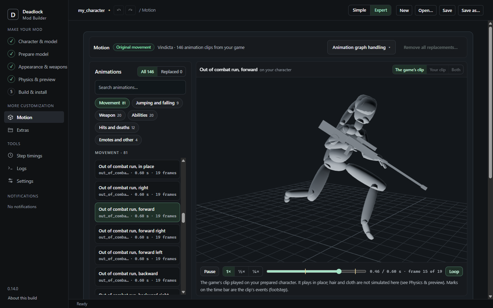

# Motion: the hero's animations

The **Motion** page is optional; it is in the sidebar in **Expert** mode (the
Simple / Expert switch is at the top of the window). Without it your character plays
the hero's own animations. On it you can look at every clip of the hero, play it
on your prepared character, and replace a clip in one of three ways: with a
compiled clip file, with a clip the app makes from your own animation, or with
the same kind of move taken from another hero in the game. The three buttons
under **Replace this clip** choose the way: **A compiled clip file**, **Make it
from my animation** or **Another hero’s animation**.

*Motion: the hero's clips in groups on the left, the selected clip playing on your character.*

Opening the page, selecting a clip or switching a view never changes your
project.

## Browsing and playing clips

The list is read from your game when the page opens (**Load the animation
list** if it did not). Clips are grouped as **Movement**, **Jumping and
falling**, **Weapon**, **Abilities**, **Hits and deaths** and **Emotes and
other**, with readable names made from the game's clip names (the clip name is
shown under each), a search, and **All** / **Replaced**. Clips that no
animation graph of the hero names are folded at the end of their group.

The **Clip player** plays the selected clip on your prepared character, so
prepare the model first (step 2); the list, replacing and the checks work
without it. Click **Show my character** to load it. The bar above the view
chooses **The game's clip**, **Your clip** (or **Your animation**) or **Both**,
where yours plays in full and the game's clip is a see-through figure in step.
Under the view are Play and Pause, the speeds 1×, ½× and ¼×, the time bar
(its marks are the clip's events) and **Loop**. The clip plays in place, and hair and cloth are not
simulated here; [Physics & preview](MODEL_PREPARATION.md#movement-preview) shows
them moving.

**About this clip** gives its length and frames, bone tracks, events, whether it
is an additive layer (the game plays it over another pose) and whether it ends
where it starts.

## Replacing a clip with a compiled clip file

1. Select the clip, and under **Replace this clip** keep **A compiled clip
   file**.
2. Drop a compiled clip (`.vnmclip_c`), or a `.vnmclip` that names your
   animation DMX, or choose it with **Choose a file…**. The clip must be made
   for this hero's skeleton, with the same length, events and root motion as
   the original: only the poses may differ.
3. **Does it fit the original?** lists the checks. The build stops on a clip
   that does not fit. A `.vnmclip` is compiled at build, so its last checks run
   then.
4. Leave **Include in build** on. A clip other heroes also use needs **Allow
   this replacement to affect other characters sharing the clip**.

## Making a clip from your own animation

The app can turn an animation you made in Blender (or in another program,
saved as FBX or glTF) into the hero's clip, so that it looks in game as it
does in your animation. Blender, FBX and glTF files (`.blend`, `.fbx`, `.glb`,
`.gltf`) are accepted; each take or animation in a file is one animation.

1. Prepare your model (step 2). A project prepared with an earlier version of
   the app needs **Prepare model** once more before a clip can be made. The
   model must be a rigged one the app prepared: a ready-made DMX or a model
   prepared as Unrigged humanoid cannot be animated this way.
2. Animate the file you prepared, or a copy of it (for example
   `my_character_wave.blend`): the armature must have the same bones and rest
   pose as your prepared character, or the page names a bone that differs.
3. On the Motion page, select the clip and choose **Make it from my animation**.
4. Under **Animation file**, **Choose file…** (or **Use my model's own file**).
   The page reads the file's animations with Blender and confirms the skeleton.
5. Choose the **Animation**. The app makes the clip with Blender; this takes a
   moment. Animations that move none of your character's bones cannot be
   chosen.

The clip keeps the game's length, events and root motion, so it always fits.
When your animation moves the body's position, the app raises or lowers the
whole body once, so the feet reach the floor as they do in the game's clip;
**What the app makes** says by how much. These choices shape it:

- **Part that plays:** **All of it, fitted to** the clip's length, or **A part
  at its own speed**, where you drag where the part starts.
- **Stay in place** (on by default): travel across the floor is removed,
  because the game moves the hero itself; crouching and hopping stay.
- **Loop:** blends the last part of your animation into its start, so the loop
  has no jump; **Blend length** sets how long.
- **How your pose is carried over:** **As it looks** (arms, legs and head point
  the way they do in your animation) or **Change from my rest pose** (for a rig
  that rests in the hero's own pose: the change from your rest pose is added to
  the hero's).
- **Which bones follow your animation:** **Every matched bone** (the whole
  body; the hero's own stance and footwork are replaced, so feet may slide) or
  **Only the bones my animation moves** (the rest keeps the game's motion; good
  for a wave or a head turn). An FBX or glTF export usually has keys for every
  bone, so for those files the second choice moves every bone too.

On a gun held with both hands, such as Vindicta's rifle, the game places the
off hand on the gun by itself. An animation that moves the chest or that arm
far from the gun therefore does not wave the arm: the hand stays on the gun
and the arm can take an odd shape to reach it.

**What the app makes** lists what the clip changes. The player's **Your
animation** and **Both** show exactly the clip the build writes. If you change
the animation file, the animation or the prepared model afterwards, the page
says so; click **Make it again**. Building needs no Blender.

Some clips cannot be made from an animation: additive clips (a lean the game
adds on top of other clips), clips that hold a single pose, and clips whose
bones the game samples in the model's space or changes in size. The page says
why, and a compiled clip file can still replace them (**Use a compiled clip file
instead**).

## Taking a move from another hero

A clip can be replaced with another hero's animation from the game, for example
to give your hero another hero's dash or run. It needs neither Blender nor a prepared
model; only the player needs your prepared character to show the result.

1. Select the clip and choose **Another hero’s animation**.
2. **Hero:** choose the hero to take the move from. Heroes whose body cannot be
   carried over to this hero are greyed out with the reason.
3. **Animation:** choose one of that hero's animations. The same move is listed
   first (**Same move**, suggested first), then similar moves, the same group
   and the others; animations that cannot be used are at the end with the
   reason.
4. **Timing:** **Fit it to this animation’s length** plays the whole animation
   faster or slower to fill the clip; **Play a part at its own speed** plays
   it at its own speed from **Starts at**, for as long as the clip lasts.
5. **Arms and hands:** **From** the other hero (its arms and hands pose as if
   holding that hero's own weapon) or **Keep** this hero's **own** (for this
   hero's grip on its own weapon).

The clip keeps this hero's length, events, sounds and travel (how far and how
fast the move goes), so it always fits the game's clip; **What you get** lists
what comes from the other hero and what stays. A move the game makes of several
animations (a dash is five, a slide three) says so, and **Take all** takes every
one of them from the other hero in one step.

Some clips cannot be taken: additive clips (a lean or a layer the game adds on
top of other clips), and clips the game stores as a single pose, with bones
sampled in the model's space or bones that change size. The page says why, and a
compiled clip file can still replace them (**Use a compiled clip file
instead**). If the other hero or its animation leaves the game after an update,
the build says so; choose another one on the Motion page.

## The page's other controls

- **Switch all replacements off** keeps your saved replacements but plays the
  game's clips; **Remove all replacements…** removes them (your files stay where
  they are).
- **Animation graph handling** holds the animation policy and the animation
  graph mode. Leave them on their defaults unless a build tells you otherwise.
- **Other saved rows** lists saved replacements the list cannot show, such as a
  clip this hero does not have.
- Saved replacements are used only while project customization is on (Extras).
- Clip replacements are not carried by
  [Make a copy for another hero](PROJECTS.md#make-a-copy-for-another-hero),
  because they belong to the first hero's clips.
