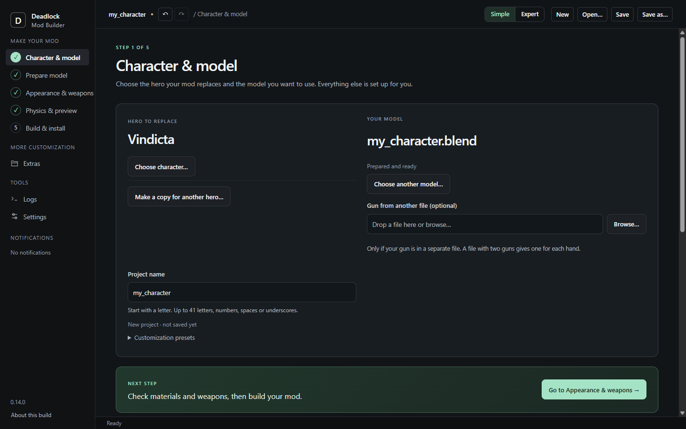
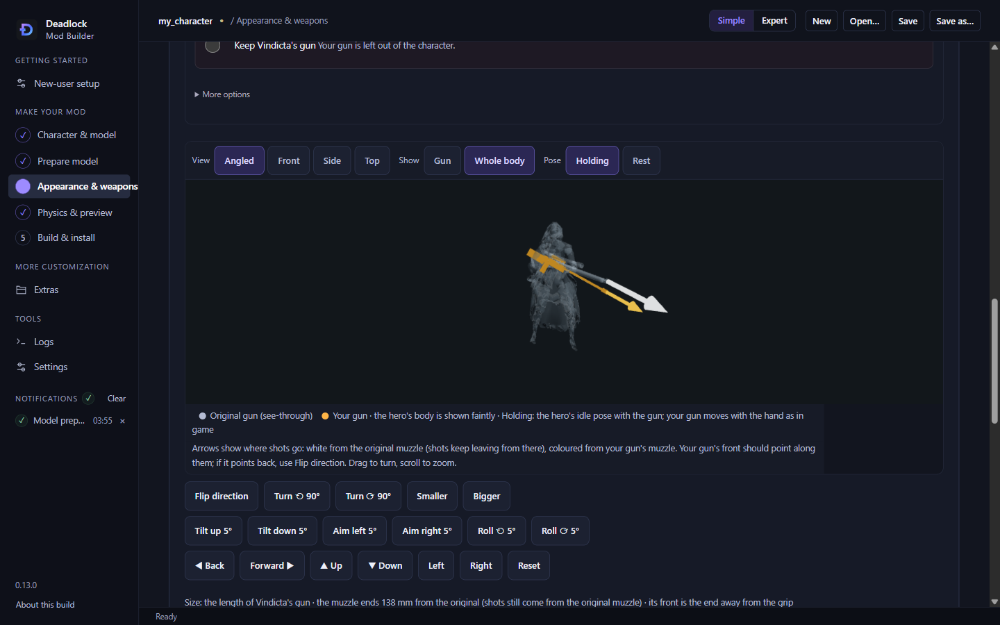
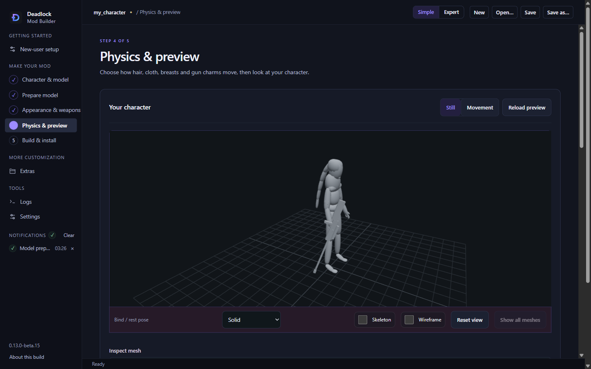
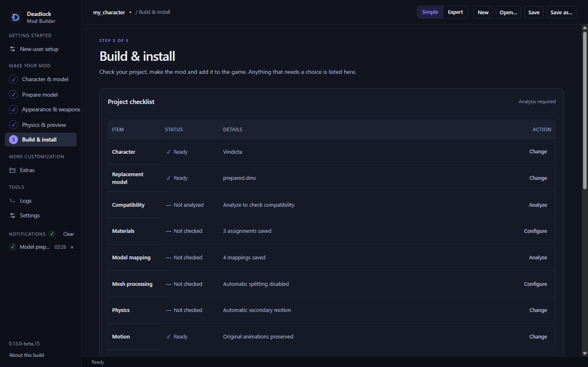

# 如何制作 Deadlock 角色模组

本教程带你从一个角色模型做出 Deadlock 中的模组。完成后，游戏的 `addons` 文件夹中会有一个 VPK，用你的模型替换某个英雄的模型。Deadlock Mod Builder 是一款开源的 Windows 应用，会带你完成五个步骤。Blender 在后台运行，负责准备模型，无需另外安装 Python。

本页介绍最快的做法。[模型准备指南](../MODEL_PREPARATION.md)（英文）详细说明了每个步骤。

应用的界面可以显示为简体中文：在“设置 → 外观”顶部的“语言”中选择，或在新手引导的第一张卡片上选择。本页在中文名称后面的括号里给出英文界面中的名称，图片显示的是英文界面。

## 所需环境

- Windows 11 x64。Windows 10 x64 应该也可以使用。
- [Microsoft Edge WebView2 Runtime](https://developer.microsoft.com/microsoft-edge/webview2/)。如果缺少，安装程序会自动添加。
- 以下四个工具：

  | 工具 | 用途 |
  | --- | --- |
  | Deadlock，通过 Steam 安装 | 选择英雄、构建和安装 |
  | [Blender](https://www.blender.org/) 4.2–4.5、5.0、5.2 LTS（推荐）或 5.3 | 准备 Blender、FBX、glTF 和 MMD 模型 |
  | [Source 2 Viewer CLI](https://github.com/ValveResourceFormat/ValveResourceFormat/releases) | 提取和反编译游戏资源 |
  | [Reduced CSDK 13](https://deadlockmodding.pages.dev/modding-tools/csdk-13) | 编译材质和英雄模型 |

- 一个绑定了骨骼的人形角色模型：Blender、FBX、glTF/GLB、MikuMikuDance（.pmx、.pmd）或已准备好的 DMX 文件。使用 Mixamo、Rigify、DAZ、Character Creator、MMD 或 ValveBiped 命名的骨骼都可以，不常见的骨骼名称也可以。非人形的身体（例如四足动物）仍然需要手动制作源文件副本（见[限制](../MODEL_PREPARATION.md#limits)（英文））。
- 仅限 MikuMikuDance 模型：在应用使用的 Blender 中安装免费的 [MMD Tools](https://extensions.blender.org/add-ons/mmd-tools/) 插件。在 Blender 中打开 Edit → Preferences → Get Extensions（中文界面为 编辑 → 偏好设置 → 获取扩展），搜索 MMD Tools，然后点击 Install（安装）。

本应用不包含 Valve 的工具、游戏文件或第三方角色模型：模型需要你自备。本应用会对你选择的文件运行 Blender 和游戏的资源工具，并写入你的 Deadlock 安装目录中的 `addons` 文件夹，所以只打开你信任的源文件和项目。

## 安装与设置

1. 从 [Releases](https://github.com/OverseerAlbedo/deadlock-mod-builder/releases) 页面下载 `DeadlockModBuilder-v<version>-windows-x64-setup.exe`。每个版本都列出了安装程序的 SHA-256。
2. 运行安装程序，然后启动 **Deadlock Mod Builder**。
3. 首次启动时会打开“新手引导”（New-user setup）页面。为应用指定这四个工具的位置（**检测工具**（Detect tools）能找到其中的大部分），点击**保存并检查工具**（Save and check tools），然后点击**测试我的设置**（Test my setup）。

顶栏中的开关用来选择简单（Simple）或专家（Expert）模式。默认是简单模式，只显示第一个模组需要的内容。你必须做出的选择永远不会被隐藏。

## 第 1 步：角色与模型（Character & model）

选择要替换的英雄模型和你的模型文件。英雄选择器按英雄名称列出游戏实际加载的模型，并把游戏不加载的名单模型标为“游戏中未使用”（Not used in game）。除非你想要另一个变体，否则请选择英雄的主模型。

如果你的枪械在单独的文件中，也可以在这里选择可选的**另一文件中的枪械**（Gun from another file）。

Blender、FBX、glTF 或 MMD 模型会直接进入第 2 步，并自动准备。

*角色与模型：选择要替换的英雄和你的模型文件。本页的图片使用一个简单的示例模型，显示的是英文界面。*

## 第 2 步：准备模型（Prepare model）

这一步把你的模型适配到英雄的骨架上。**自动准备**（Prepare automatically）会一次完成检查你的文件、应用建议、检查结果、转换并使用该模型，然后进入第 3 步。你自己的文件永远不会被改写。

准备通常会自行完成。如果中途停下，它会指出需要你决定的内容（例如关节匹配或形态键的选择），并提供直达每一处的按钮。如果你的模型带有形态键，**形态键处理**（Shape key handling）是必选项（适配与检查（Fit & review）→ 形态键（Shape keys））。

检查完成后，页面顶部的栏会显示你的文件名，并提供它的菜单：**模型文件与朝向**（Model file & orientation，用于选择另一个文件或重新检查）、准备模式、**场景对象**（Scene objects）和**备注**（Notes）。你在**身体部位**（Body roles）、**活动部件**（Moving parts）、**关节匹配**（Joint matches）、**枪械**（Gun）和**适配与检查**这几个选项卡之间切换时，3D 视图始终留在左侧；每个选项卡都会显示简短的状态。加载“关节检查”（Joint check）视图，就能在角色上看到标签：在**身体部位**中点击某个关节的标签即可选中它，你的模型中由该骨骼带动的部分会亮起来。在**枪械**选项卡上，枪械的适配预览和它的调整按钮会代替 3D 视图。

## 第 3 步：外观与武器（Appearance & weapons）

在 3D 预览中检查枪械的适配，检查材质和贴图，然后接受它们。页面在 3D 视图旁有四个选项卡（**材质**（Materials）、**面部**（Face）、**枪械**、**配饰与道具**（Accessories & props）），顶栏中有四个菜单：**模型**（Model，替换或分析模型、导入源文件包）、**网格选项**（Mesh options）、**贴图文件夹**（Texture folder）和**已保存的输入**（Saved inputs）。

- 枪械：如果你的模型包含枪械，**枪械**选项卡会让你选择把它适配到英雄的枪械上、不使用它，或者让它留在手中。推荐用你的枪械代替英雄的枪械，这一项也是默认选中的。预览会把你的枪械叠在英雄自己的枪械上显示。如果枪械朝向后方，请使用**翻转方向**（Flip direction）；其他按钮可以旋转、倾斜和移动它。**应用枪械更改**（Apply gun changes）只需一次点击就会重新准备模型。
- 材质：贴图会从你模型的材质中找到。在**材质**选项卡上，点击列表中的某个材质或 3D 视图中角色的某个部分，检查它的图片，然后勾选**我已检查此材质选择**（I have reviewed this material choice）；**下一个待检查**（Next to review）会跳到下一个，**全部接受**（Accept all）会一次接受所有已解决的选择。颜色在**附加内容 → 颜色**（Extras → Colors）中修改。

*外观与武器：适配预览把你的枪械叠在英雄自己的枪械上显示，并提供旋转、倾斜和移动它的按钮。*

## 第 4 步：物理与预览（Physics & preview）

头发、尾巴、耳朵、裙子、布料和飘带可以自行摆动。在**物理模式**（Physics mode）选项卡上选择**自动物理摆动**（Automatic secondary motion），然后在**微调**（Fine-tune）中调整它们的动态效果，在**活动部件**中打开或关闭各个部件。角色预览始终显示在每个选项卡旁边；点击角色上的标签，即可微调这一类部件。

预览上方栏中的**动态**（Movement）会在你的角色上播放英雄自己的动画片段：站立、奔跑（向前、向后和向两侧）、停下、跳跃和下落。使用自动物理摆动时，它会模拟游戏自己的布料模型，因此活动部件的摆动会更接近你在游戏中看到的效果；但仍然需要在对局中检查。

*物理与预览：在 3D 中查看准备好的角色，并选择它的活动部件如何摆动。*

## 第 5 步：构建与安装（Build & install）

分析、构建并安装。应用会检查项目、编译模型和材质、打包 VPK 并安装它。

构建之前，请查看本页上的网格映射。你的网格以源文件中的名称命名（Body、Face），而不是英雄的渲染节点名称，所以页面会提供**建议的映射**（suggested mapping）：**应用建议的映射**（Apply suggested mapping）只需一次点击，就会把所有未被渲染节点使用的网格放到身体上，保留英雄的武器部件和英雄携带的物品，并关闭英雄的其他部件。在你点击它之前，不会应用任何更改。未被任何渲染节点使用的源网格在游戏中会缺失；警告会列出这些网格，并提供把它们添加到主节点的按钮。

如果某项检查阻止了构建，请修正报告中指出的输入。绕过检查只会得到损坏的或没有任何变化的模组。分析（Analyze）还会报告被其他模组占用的 VPK 槽位。

*构建与安装：构建前的项目检查清单。*

项目保存为 `.dmb.json` 文件。

## 在游戏中检查

在 Deadlock 中检查角色。“构建与安装”页面会列出需要在游戏中查看的内容。构建成功和预览都不能代替在对局中查看角色。请查看：

- 握持、瞄准和枪口位置（射击和枪口火光来自原有的枪口骨骼）；
- 肘部和膝部的弯曲；
- 穿模；
- 对于双手各持一把枪的英雄，双枪动画；
- 活动部件的摆动。

## 出现问题时

- **设置（Settings）中有路径显示为红色**：使用它提供的 **使用…**（Use …）修复，或点击**修复所有标记的路径**（Fix all marked paths），然后点击**测试我的设置**。见[设置](../TROUBLESHOOTING.md#setup)（英文）。
- **准备中途停下**：“准备模型”步骤会指出相关的对象或关节，并提供直达它的按钮。由实时控制器驱动的骨架可能需要先烘焙再导出。见[模型与映射](../TROUBLESHOOTING.md#models-and-mapping)（英文）。
- **枪械朝向后方或上下颠倒**：在适配预览中翻转或滚转它，然后在游戏中检查瞄准和握持。见[枪械](../TROUBLESHOOTING.md#guns)（英文）。
- **游戏中的模型不对**：检查英雄的模型路径、VPK 槽位和互相冲突的模组。见[枪械](../TROUBLESHOOTING.md#guns)（英文），那里也介绍了如何选择英雄的主模型。
- **游戏中的动态效果与预览不同**：预览接近游戏中的布料效果，但并不完全一致；调整微调滑块，然后重新分析和构建。见[物理](../TROUBLESHOOTING.md#physics)（英文）。
- **需要帮助**：使用**日志**（Logs）和**步骤耗时**（Step timings）找到失败的阶段，然后附上**复制支持信息**（Copy for support）得到的文本报告问题。见[日志](../TROUBLESHOOTING.md#logs)（英文）。

## 后续步骤

- [简单与专家模式](../MODEL_PREPARATION.md#simple-and-expert)（英文）：专家模式会显示哪些内容。
- [枪械](../MODEL_PREPARATION.md#guns)（英文）：持两把枪的英雄、另一文件中的枪械，以及枪械挂饰。
- [活动部件](../MODEL_PREPARATION.md#moving-parts)（英文）和[动态预览](../MODEL_PREPARATION.md#fine-tune-and-the-movement-preview)（英文）：部件类型、微调滑块和已保存的预设。
- [颜色](../MODEL_PREPARATION.md#colors)（英文）：在角色上点击一种颜色，为英雄自己的服装或你的替换模型的材质重新着色。
- 其他附加内容：[声音](../MODEL_PREPARATION.md#hero-sounds)（英文）、[特效](../MODEL_PREPARATION.md#hero-effects)（英文）、[物品图标](../MODEL_PREPARATION.md#item-icons)（英文）、[物品名称](../MODEL_PREPARATION.md#item-names)（英文）和[技能物体](../MODEL_PREPARATION.md#ability-objects)（英文）。
- [动作](../MOTION.md)（英文）：在你的角色上播放英雄的动画并替换动画片段，也可以用你自己的动画或游戏中另一位英雄的动画来替换。
- [项目与已安装的模组](../PROJECTS.md)（英文）：撤销和重做、为另一位英雄制作项目副本，以及已安装模组的列表。
- [故障排除](../TROUBLESHOOTING.md)（英文）：兼容性限制和常见故障的解决方法。
